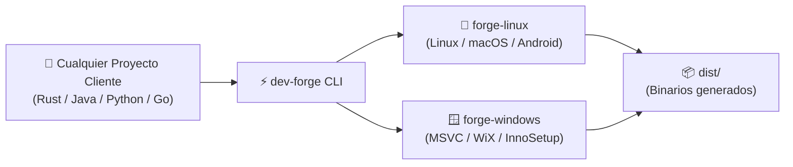

# dev-forge 🔨

> **Forja Universal de Compilación y Desarrollo Multiplataforma (100% Offline)**

`dev-forge` es un orquestador autónomo diseñado para compilar y empaquetar aplicaciones en múltiples lenguajes (**Rust, Java, Android, Python, Go, Node.js y C/C++**) hacia múltiples plataformas (**Linux, Windows nativo con MSVC y macOS**) mediante entornos virtualizados limpios y aislados, sin requerir conexión a internet obligatoria ni contaminar el sistema operativo anfitrión.

---

## 🚀 Flujo de Trabajo



---

## 🌟 Características Principales

- **🎯 100% Offline**: Ejecución y empaquetado directo en local sin depender de GitHub Actions ni subir código a la nube.
- **🌐 Soporte Multi-Lenguaje Nativo**:
  - **Rust**: Soporte completo para aplicaciones CLI y GUIs en Tauri.
  - **Java & Android**: OpenJDK 21 LTS, Gradle y compilación de paquetes móviles APK/AAB.
  - **Python**: Empaquetado en ejecutables independientes con PyInstaller y gestión con UV.
  - **Go**: Binarios estáticos de alto rendimiento.
  - **C / C++**: GCC, Clang, CMake y MSVC nativo con enlazado criptográfico del sistema.
  - **Node.js**: Entorno LTS y empaquetadores web modernos.
- **🛡️ Entornos Aislados e Inmutables**:
  - `forge-linux`: Debian 12 optimizado con enlazador ultrarrápido `mold` y Docker para compilación cruzada hacia macOS.
  - `forge-windows`: Windows 11 con Visual Studio 2022 Community (MSVC nativo) y generadores de instaladores (WiX / InnoSetup).
- **📂 Higiene Absoluta en el Proyecto Cliente**: El proyecto cliente no necesita scripts complejos de virtualización; `dev-forge` monta temporalmente la carpeta y deposita los resultados en `dist/`.
- **🔗 Integración Universal con Agentes**: Conexión simbólica directa a `.agents` para heredar las directrices y estándares del ecosistema central.

---

## 📦 Instalación y Requisitos en el Host

`dev-forge` está diseñado para ejecutarse como orquestador anfitrión en **Linux**, **Windows** y **macOS**:

### Requisitos por Sistema Operativo Anfitrión

| Sistema Anfitrión | Hipervisor & Herramientas | Shell Compatible | Instalación Recomendada |
| :--- | :--- | :--- | :--- |
| **Linux** (Debian, Ubuntu, Fedora, Arch) | VirtualBox (>= 7.0), Vagrant (>= 2.3) | **Bash** (>= 4.0) | `sudo apt install virtualbox vagrant` |
| **Windows** (10 / 11) | VirtualBox (>= 7.0), Vagrant (>= 2.3) | **PowerShell** (5.1 o 7+) | `winget install Oracle.VirtualBox HashiCorp.Vagrant` o `choco install virtualbox vagrant` |
| **macOS** (Intel / Apple Silicon) | VirtualBox (>= 7.0), Vagrant (>= 2.3) | **Zsh** o **Bash** | `brew install --cask virtualbox vagrant` |

> [!NOTE]
> En **macOS con Apple Silicon (M1/M2/M3/M4)**, VirtualBox 7.x ejecuta máquinas virtuales compatibles con arquitecturas ARM. Para compilar ejecutables x86_64 o Windows MSVC, la forja se apoya en emulación y en el compilador cruzado `forge-linux`.

---

### Preparación del CLI

#### En Linux y macOS (Bash / Zsh):
Añade `dev-forge` a tu `PATH` o crea un alias en tu archivo de configuración (`~/.bashrc` o `~/.zshrc`):
```bash
# Añadir al PATH permanentemente
export PATH="/home/usuario/DEV/dev-forge/bin:$PATH"

# O mediante alias rápido
alias dev-forge="/home/usuario/DEV/dev-forge/bin/dev-forge"
```

#### En Windows (PowerShell):
Añade la ruta al perfil de PowerShell (`notepad $PROFILE`):
```powershell
# Añadir al PATH de la sesión o del usuario
$env:Path += ";C:\DEV\dev-forge\bin"

# O crear un alias en tu $PROFILE
Set-Alias -Name dev-forge -Value "C:\DEV\dev-forge\bin\dev-forge.ps1"
```

---

## 💻 Uso Rápido del CLI

El orquestador ofrece paridad total de comandos en ambos shells:

### 1. Compilar cualquier proyecto

#### En Linux / macOS (Bash / Zsh):
```bash
# Compilar proyecto en Rust o Tauri hacia todos los destinos
dev-forge build --project /ruta/a/mi-proyecto --target all

# Compilar proyecto Java hacia Android (APK)
dev-forge build --project /ruta/a/mi-app-android --target android

# Compilar script Python en un ejecutable Windows PE32+
dev-forge build --project /ruta/a/mi-script --target windows
```

#### En Windows (PowerShell):
```powershell
# Compilar proyecto en Rust o Tauri hacia todos los destinos
.\bin\dev-forge.ps1 build -p C:\proyectos\mi-proyecto -t all

# Compilar proyecto Java hacia Android (APK)
.\bin\dev-forge.ps1 build -p C:\proyectos\mi-app-android -t android

# Compilar ejecutable nativo Windows con MSVC
.\bin\dev-forge.ps1 build -p C:\proyectos\mi-script -t windows
```

### 2. Gestión de Máquinas Virtuales

#### En Linux / macOS:
```bash
dev-forge status         # Consultar estado de las VMs
dev-forge up forge-linux # Iniciar máquina Linux
dev-forge halt           # Detener todas las VMs para liberar RAM
dev-forge ssh            # Abrir terminal interactiva en forge-linux
```

#### En Windows:
```powershell
.\bin\dev-forge.ps1 status         # Consultar estado de las VMs
.\bin\dev-forge.ps1 up forge-linux # Iniciar máquina Linux
.\bin\dev-forge.ps1 halt           # Detener todas las VMs
.\bin\dev-forge.ps1 ssh            # Sesión SSH en Linux
```

---

## 📚 Documentación Técnica Detallada

Para consultar detalles de implementación, diagramas de arquitectura interna o guías específicas, revisa los documentos dedicados:

- 📐 **[Arquitectura del Sistema y Flujo de Datos](docs/architecture.md)**
- 🍏 **[Compilación y Firmado de GUIs para macOS desde Linux](docs/macos-gui-compilation.md)**
- 📖 **[Referencia de Lenguajes y Ecosistemas Soportados](docs/supported-languages.md)**
- 📋 **[Registro de Cambios (Changelog)](CHANGELOG.md)**

---

## 📄 Licencia

Este proyecto está licenciado bajo los estándares internos del ecosistema de desarrollo de software.

