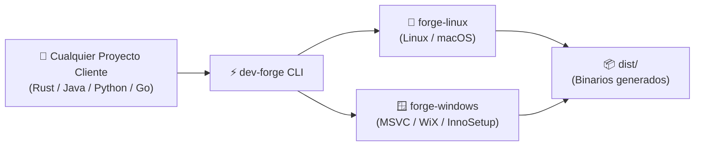

# dev-forge 🔨

> **Forja Universal de Compilación y Desarrollo Multiplataforma (100% Offline)**

`dev-forge` es un orquestador autónomo diseñado para compilar y empaquetar aplicaciones en múltiples lenguajes (**Rust, Java, Python, Go, Node.js y C/C++**) hacia múltiples plataformas (**Linux, Windows nativo con MSVC y macOS**) mediante entornos virtualizados limpios y aislados, sin requerir conexión a internet obligatoria ni contaminar el sistema operativo anfitrión.

---

## 🚀 Flujo de Trabajo



---

## 🌟 Características Principales

- **🎯 100% Offline**: Ejecución y empaquetado directo en local sin depender de GitHub Actions ni subir código a la nube.
- **🌐 Soporte Multi-Lenguaje Nativo**:
  - **Rust**: Soporte completo para aplicaciones CLI y GUIs en Tauri.
  - **Java**: OpenJDK 21 LTS y Gradle.
  - **Python**: Empaquetado en ejecutables independientes con PyInstaller y gestión con UV.
  - **Go**: Binarios estáticos de alto rendimiento.
  - **C / C++**: GCC, Clang, CMake y MSVC nativo con enlazado criptográfico del sistema.
  - **Node.js**: Entorno LTS y empaquetadores web modernos.
- **🛡️ Entornos Aislados e Inmutables**:
  - `forge-linux`: Debian 12 optimizado con enlazador ultrarrápido `mold` y Docker para compilación cruzada hacia macOS.
  - `forge-windows`: Windows Server 2022 Standard Core con Visual Studio 2022 Build Tools (MSVC nativo) y generadores de instaladores (WiX / InnoSetup).
- **📂 Higiene Absoluta en el Proyecto Cliente**: El proyecto cliente no necesita scripts complejos de virtualización; `dev-forge` monta temporalmente la carpeta y deposita los resultados en `dist/`.
- **🔗 Integración Universal con Agentes**: Conexión simbólica directa a `.agents` para heredar las directrices y estándares del ecosistema central.

---

## 📦 Instalación y Requisitos en el Host

`dev-forge` está diseñado para ejecutarse como orquestador anfitrión en **Linux**, **Windows** y **macOS**:

### Requisitos por Sistema Operativo Anfitrión

| Sistema Anfitrión | Hipervisor & Herramientas | Shell Compatible | Instalación Recomendada |
| :--- | :--- | :--- | :--- |
| **Linux** (Debian, Ubuntu, Fedora, Arch) | VirtualBox (>= 7.0), Vagrant (>= 2.3) | **Bash** (>= 4.0) | `sudo apt install virtualbox vagrant` |
| **Windows** (10 / 11) | VirtualBox (>= 7.0), Vagrant (>= 2.3) | **PowerShell** (5.1 o 7+) | `winget install Oracle.VirtualBox HashiCorp.Vagrant` o `choco install virtualbox vagrant` |
| **macOS** (Intel / Apple Silicon) | VirtualBox (>= 7.0), Vagrant (>= 2.3) | **Zsh** o **Bash** | `brew install --cask virtualbox vagrant` |

> [!NOTE]
> En **macOS con Apple Silicon (M1/M2/M3/M4)**, VirtualBox 7.x ejecuta máquinas virtuales compatibles con arquitecturas ARM. Para compilar ejecutables x86_64 o Windows MSVC, la forja se apoya en emulación y en el compilador cruzado `forge-linux`.

---

### Preparación del CLI

#### Instalación Automática en `~/.local/bin` (Recomendada):
Ejecuta el auto-dimensionamiento del host o el comando de instalación de binario:
```bash
# Auto-detecta recursos e instala el ejecutable dev-forge en ~/.local/bin/dev-forge
dev-forge tune

# O alternativamente:
dev-forge install-bin
```
Asegúrate de que `~/.local/bin` forme parte de tu `$PATH` (estándar en la mayoría de distribuciones modernas). Una vez hecho, podrás invocar `dev-forge` directamente desde cualquier terminal y desde cualquier directorio.

#### En Linux y macOS (Bash / Zsh):
También puedes añadir la carpeta `bin/` al `PATH` o definir un alias:
```bash
# Añadir al PATH permanentemente
export PATH="/home/usuario/DEV/dev-forge/bin:$PATH"

# O mediante alias rápido
alias dev-forge="/home/usuario/DEV/dev-forge/bin/dev-forge"
```

#### En Windows (PowerShell):
Añade la ruta al perfil de PowerShell (`notepad $PROFILE`):
```powershell
# Añadir al PATH de la sesión o del usuario
$env:Path += ";C:\DEV\dev-forge\bin"

# O crear un alias en tu $PROFILE
Set-Alias -Name dev-forge -Value "C:\DEV\dev-forge\bin\dev-forge.ps1"
```

#### Ejecución Directa con Python 3:
Alternativamente, `dev-forge` puede ejecutarse directamente mediante su motor en Python sin requerir compilación previa:
```bash
# Lanzador directo
python3 dev-forge.py --help

# O como módulo instalado
python3 -m dev_forge tune
```

---

## 💻 Uso Rápido del CLI

El orquestador ofrece paridad total de comandos en ambos shells:

### 1. Compilar cualquier proyecto

#### Menú Interactivo Guiado (Por Defecto):
Si ejecutas `dev-forge build` sin parámetros, el orquestador inicia un asistente interactivo en terminal para guiarte en 4 pasos:
1. **Selección de Proyecto**: Si te encuentras en un proyecto, lo selecciona automáticamente; si estás en un directorio neutro, te permite elegir entre los últimos 5 proyectos usados o introducir una ruta manual (con soporte para `~`).
2. **Componente**: Todos (CLI + GUI), solo CLI, solo aplicación GUI o ejecutables de prueba (`test runners`).
3. **Destino (Target OS)**: Todos (Linux, Windows, macOS), solo Linux, solo Windows o solo macOS.
4. **Formato de Salida**: Binarios directos + Paquetes/Instaladores (AppImage, deb, rpm, MSI, Inno Setup), solo binarios o solo paquetes.
5. **Modo**: Release (optimizado) o Testing / Debug.

```bash
# Lanzar asistente interactivo
dev-forge build
```

#### Modo No Interactivo (Flags Directos):
```bash
# Compilar proyecto en Rust o Tauri hacia todos los destinos
dev-forge build -p /ruta/a/mi-proyecto -t all

# Compilar solo la aplicación GUI de escritorio hacia Windows
dev-forge build -p /ruta/a/mi-proyecto -t windows --component gui

# Compilar solo ejecutables para pruebas / test suite en Linux
dev-forge build -p /ruta/a/mi-proyecto -t linux --test

# Compilar proyecto en Java (JAR)
dev-forge build -p /ruta/a/mi-app-java -t linux

# Compilar script Python en ejecutable Windows con Nuitka (C nativo)
dev-forge build -p /ruta/a/mi-script -t windows --compiler nuitka
```

#### En Windows (PowerShell):
```powershell
# Compilar proyecto en Rust o Tauri hacia todos los destinos
.\bin\dev-forge.ps1 build -p C:\proyectos\mi-proyecto -t all

# Compilar proyecto en Java (JAR)
.\bin\dev-forge.ps1 build -p C:\proyectos\mi-app-java -t linux

# Compilar ejecutable nativo Windows con MSVC
.\bin\dev-forge.ps1 build -p C:\proyectos\mi-script -t windows

# Compilar Python con Nuitka (Ahead-of-Time C)
.\bin\dev-forge.ps1 build -p C:\proyectos\mi-script -t windows -c nuitka
```

### 2. Gestión de Máquinas Virtuales

#### En Linux / macOS:
```bash
dev-forge status         # Consultar estado de las VMs
dev-forge up forge-linux # Iniciar máquina Linux
dev-forge halt           # Detener todas las VMs para liberar RAM
dev-forge ssh            # Abrir terminal interactiva en forge-linux
```

#### En Windows (PowerShell):
```powershell
.\bin\dev-forge.ps1 status         # Consultar estado de las VMs
.\bin\dev-forge.ps1 up forge-linux # Iniciar máquina Linux
.\bin\dev-forge.ps1 halt           # Detener todas las VMs
.\bin\dev-forge.ps1 ssh            # Sesión SSH en Linux
```

### 3. Validación de Salud y Pruebas del Entorno (`test-vm`)

Para verificar que los toolchains, variables del kernel y enlazadores estén 100% operativos dentro de cada máquina virtual:

#### En Linux / macOS:
```bash
dev-forge test-vm forge-linux   # Verifica servicios, kernel sysctl, tmpfs y ccache en Debian 12
dev-forge test-vm forge-windows # Verifica toolchains (MSVC, Rust, Python, Go, Node, Java, CMake, Ninja)
```

#### En Windows:
```powershell
.\bin\dev-forge.ps1 test-vm forge-linux
.\bin\dev-forge.ps1 test-vm forge-windows
```

### 4. Diagnóstico Pre-Vuelo (`doctor`) y Mantenimiento de Caché

Audita automáticamente la virtualización por hardware (VT-x/AMD-V), memoria RAM, espacio en disco, estado de VirtualBox/Vagrant, puertos y controladores del host:

#### En Linux / macOS:
```bash
dev-forge doctor                     # Auditoría integral pre-vuelo del host y las VMs
dev-forge clean-cache                # Limpiar toda la caché persistente (~/.dev-forge/cache)
dev-forge clean-cache -s cargo       # Limpiar solo la caché de un subsistema (cargo, go, pip, gradle, sccache)
```

#### En Windows:
```powershell
.\bin\dev-forge.ps1 doctor
.\bin\dev-forge.ps1 clean-cache
.\bin\dev-forge.ps1 clean-cache -s cargo
```

### 5. Configuración de Entornos de Desarrollo en VS Code (`ide`)

`dev-forge` permite convertir la máquina virtual `forge-linux` en un entorno de desarrollo interactivo para VS Code conectado vía SSH con todas las herramientas nativas del lenguaje:

```bash
# Configurar entorno para Rust (rust-analyzer, lldb, tareas cargo)
dev-forge ide setup-vscode -p /ruta/a/mi-proyecto --profile rust

# Configurar entorno para Python (intérprete VM, ruff)
dev-forge ide setup-vscode -p /ruta/a/mi-proyecto --profile python

# Otros perfiles disponibles: go, java, c
dev-forge ide setup-vscode -p /ruta/a/mi-proyecto --profile go
```

---

## 🧪 Banco de Pruebas Multi-Lenguaje (`HashForge`)

`dev-forge` incluye un banco de pruebas integral en [`examples/hashforge/`](examples/hashforge/README.md) compuesto por **7 implementaciones** que calculan exactamente los mismos resúmenes criptográficos (**SHA-256** y **MD5**) sobre un vector de prueba constante (`"dev-forge test"`):

- **SHA-256 esperado**: `3424cecd9bc9384046f4b97b5012cc51037a0a58cbf547642dc71dc6a0ac0825`
- **MD5 esperado**: `253c885072f588436970bcbc0fe47b9e`

### Matriz de Lenguajes Soportados en el Test

| Lenguaje | Directorio | Sistema de Construcción | Salida Linux | Salida Windows (Binario + Setup + MSI) |
| :--- | :--- | :--- | :--- | :--- |
| **Rust** | [`rust/`](examples/hashforge/rust/) | Cargo | `dist/hashforge` (ELF 64-bit) | `dist/hashforge.exe` + `-setup.exe` + `.msi` |
| **Python** | [`python/`](examples/hashforge/python/) | PyInstaller / UV | `dist/hashforge-py` | `dist/hashforge-py.exe` + `-setup.exe` + `.msi` |
| **C (C99)** | [`c/`](examples/hashforge/c/) | CMake / OpenSSL / CryptoAPI | `dist/hashforge-c` | `dist/hashforge-c.exe` + `-setup.exe` + `.msi` |
| **C++ (C++17)** | [`cpp/`](examples/hashforge/cpp/) | CMake / Ninja / MSVC | `dist/hashforge-cpp` | `dist/hashforge-cpp.exe` + `-setup.exe` + `.msi` |
| **Go** | [`go/`](examples/hashforge/go/) | Go toolchain | `dist/hashforge-go` | `dist/hashforge-go.exe` + `-setup.exe` + `.msi` |
| **Java** | [`java/`](examples/hashforge/java/) | Gradle (Java 21 LTS) | `dist/hashforge-java.jar` | `dist/hashforge-java.jar` |
| **Node.js** | [`node/`](examples/hashforge/node/) | Node.js / Web Crypto | `dist/hashforge-node.js` | `dist/hashforge-node.js` |

> [!TIP]
> **Empaquetado e Iconos Automáticos en Windows**: En cada compilación para Windows, `dev-forge` detecta automáticamente si el proyecto tiene un icono (`.ico` o `.png`, con conversión automática a ICO multi-resolución) y genera simultáneamente en `dist/` el ejecutable autónomo (`.exe`), el instalador ejecutable Inno Setup (`<app>-setup.exe`) y el paquete corporativo Windows Installer (`<app>.msi`), vinculando el icono a accesos directos y al desinstalador de Windows.

### Ejecución de Pruebas para Todos los Lenguajes

#### En Linux / macOS (Bash):
```bash
# Ejecutar TODOS los lenguajes en AMBAS máquinas virtuales (Linux y Windows):
bash examples/hashforge/test.sh all all

# Ejecutar TODOS los lenguajes SOLO en Linux:
bash examples/hashforge/test.sh all linux

# Ejecutar TODOS los lenguajes SOLO en Windows:
bash examples/hashforge/test.sh all windows

# Probar un lenguaje específico (ej. rust, python, go, java, c, cpp, node):
bash examples/hashforge/test.sh rust linux
bash examples/hashforge/test.sh rust windows
bash examples/hashforge/test.sh python windows
```

#### En Windows (PowerShell):
```powershell
# Ejecutar TODOS los lenguajes en AMBAS máquinas virtuales:
.\examples\hashforge\test.ps1 -Language all -Target all

# Ejecutar TODOS los lenguajes SOLO en Windows:
.\examples\hashforge\test.ps1 -Language all -Target windows

# Probar un lenguaje específico:
.\examples\hashforge\test.ps1 -Language rust -Target windows
.\examples\hashforge\test.ps1 -Language python -Target windows
.\examples\hashforge\test.ps1 -Language java -Target windows
```

> [!NOTE]
> Para más detalles sobre cada lenguaje y compilación individual, consulta la [Guía Completa de HashForge](examples/hashforge/README.md).

---

## 📚 Documentación Técnica Detallada

Para consultar detalles de implementación, diagramas de arquitectura interna o guías específicas, revisa los documentos dedicados:

- 📐 **[Arquitectura del Sistema y Flujo de Datos](docs/architecture.md)**
- 🤖 **[Arquitectura de Subagentes Especializados y Flujo de Delegación](docs/subagents.md)**
- 🍏 **[Compilación y Firmado de GUIs para macOS desde Linux](docs/macos-gui-compilation.md)**
- 📖 **[Referencia de Lenguajes y Ecosistemas Soportados](docs/supported-languages.md)**
- 📋 **[Registro de Cambios (Changelog)](CHANGELOG.md)**

---

## 📄 Licencia

Este proyecto está licenciado bajo los estándares internos del ecosistema de desarrollo de software.

