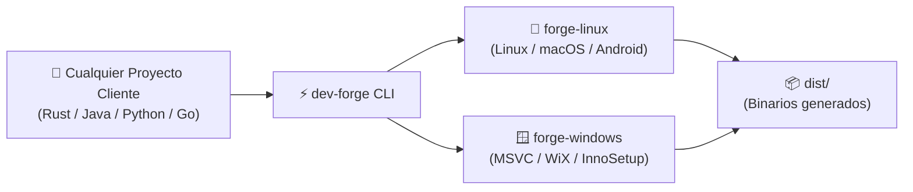

# dev-forge 🔨

> **Forja Universal de Compilación y Desarrollo Multiplataforma (Modo B Offline)**

`dev-forge` es un orquestador autónomo diseñado para compilar y empaquetar aplicaciones en múltiples lenguajes (**Rust, Java, Android, Python, Go, Node.js y C/C++**) hacia múltiples plataformas (**Linux, Windows nativo con MSVC y macOS**) mediante entornos virtualizados limpios y aislados, sin requerir conexión a internet obligatoria ni contaminar el sistema operativo anfitrión.

---

## 🚀 Flujo de Trabajo



---

## 🌟 Características Principales

- **🎯 Modo B (100% Offline)**: Ejecución y empaquetado directo en local sin depender de GitHub Actions ni subir código a la nube.
- **🌐 Soporte Multi-Lenguaje Nativo**:
  - **Rust**: Soporte completo para aplicaciones CLI y GUIs en Tauri.
  - **Java & Android**: OpenJDK 21 LTS, Gradle y compilación de paquetes móviles APK/AAB.
  - **Python**: Empaquetado en ejecutables independientes con PyInstaller y gestión con UV.
  - **Go**: Binarios estáticos de alto rendimiento.
  - **Node.js**: Entorno LTS y empaquetadores web modernos.
- **🛡️ Entornos Aislados e Inmutables**:
  - `forge-linux`: Debian 12 optimizado con enlazador ultrarrápido `mold` y Docker para compilación cruzada hacia macOS.
  - `forge-windows`: Windows 11 con Visual Studio 2022 Community (MSVC nativo) y generadores de instaladores (WiX / InnoSetup).
- **📂 Higiene Absoluta en el Proyecto Cliente**: El proyecto cliente no necesita scripts complejos de virtualización; `dev-forge` monta temporalmente la carpeta y deposita los resultados en `dist/`.
- **🔗 Integración Universal con Agentes**: Conexión simbólica directa a `.agents` para heredar las directrices y estándares del ecosistema central.

---

## 📦 Instalación y Requisitos

### Requisitos en el Host
1. **VirtualBox** (>= 7.0)
2. **Vagrant** (>= 2.3)
3. **Bash** y utilidades estándar

### Preparación del CLI
Puedes añadir `dev-forge` a tu `PATH` personal o crear un alias en tu shell (`~/.bashrc` o `~/.zshrc`):

```bash
# Añadir al PATH
export PATH="/home/olorinj/DEV/dev-forge/bin:$PATH"

# O mediante alias rápido
alias dev-forge="/home/olorinj/DEV/dev-forge/bin/dev-forge"
```

---

## 💻 Uso Rápido del CLI

### 1. Compilar cualquier proyecto
```bash
# Compilar proyecto en Rust o Tauri hacia todos los destinos
dev-forge build --project /ruta/a/mi-proyecto --target all

# Compilar proyecto Java hacia Android (APK / AAB)
dev-forge build --project /ruta/a/mi-app-android --target android

# Compilar script Python en un ejecutable Windows
dev-forge build --project /ruta/a/mi-script --target windows
```

### 2. Gestión de Máquinas Virtuales
```bash
# Consultar el estado de las máquinas de la forja
dev-forge status

# Iniciar manualmente una máquina específica
dev-forge up forge-linux

# Detener máquinas para liberar memoria RAM y CPU
dev-forge halt

# Acceder por SSH a la máquina Linux
dev-forge ssh
```

---

## 📚 Documentación Técnica Detallada

Para consultar detalles de implementación, diagramas de arquitectura interna o guías específicas, revisa los documentos dedicados:

- 📐 **[Arquitectura del Sistema y Flujo de Datos](docs/architecture.md)**
- 🍏 **[Compilación y Firmado de GUIs para macOS desde Linux](docs/macos-gui-compilation.md)**
- 📖 **[Referencia de Lenguajes y Ecosistemas Soportados](docs/supported-languages.md)**

---

## 📄 Licencia

Este proyecto está licenciado bajo los estándares internos del ecosistema de desarrollo de software.
