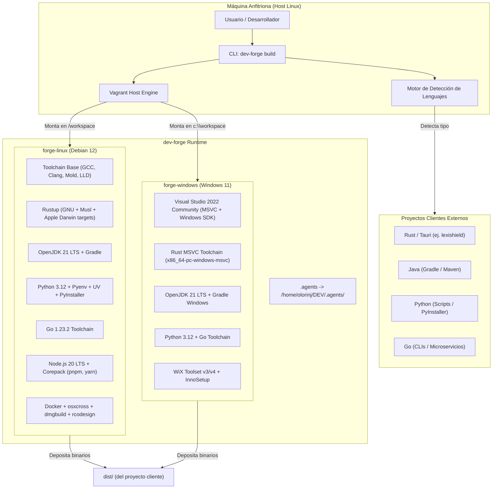
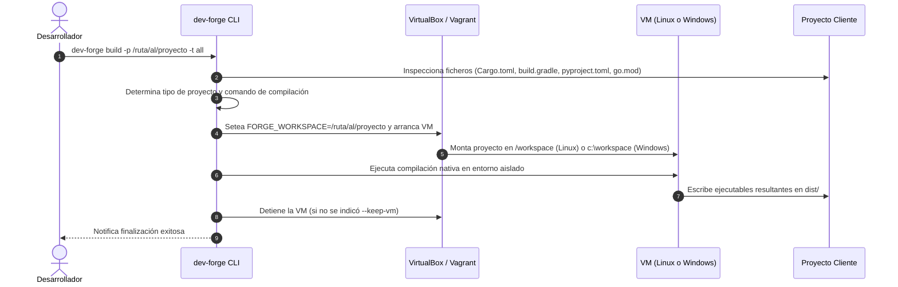

# Arquitectura del Sistema - `dev-forge`

`dev-forge` es una plataforma desacoplada de virtualización y compilación cruzada multi-lenguaje concebida para ejecutar compilaciones limpias e independientes del host (100% offline).

## 1. Diagrama de Arquitectura Global



---

## 2. Flujo de Compilación Desacoplada (100% Offline)



---

## 3. Principios de Aislamiento y Seguridad
1. **Host Inmutable**: La máquina host no requiere tener instalados compiladores de Windows, emuladores ni SDKs pesados.
2. **Cero Polución**: Las dependencias temporales y archivos intermedios de compilación se procesan dentro de la VM, manteniendo el proyecto cliente limpio.
3. **Persistencia de Bóveda y Agentes**: El enlace simbólico a `.agents` asegura el cumplimiento de las directrices y estándares universales del ecosistema.

---

## 4. Optimizaciones de Rendimiento y Virtualización

Para garantizar compilaciones a máxima velocidad de I/O y red, la arquitectura incorpora los siguientes mecanismos:

### 4.1 VirtIO Networking
- En la máquina Linux (`forge-linux`), la tarjeta de red NAT principal está configurada con `--nictype1 virtio`.
- Esto reduce drásticamente la sobrecarga de interrupciones del kernel emuladas y acelera la descarga de dependencias externas (crates de crates.io, paquetes npm, módulos Go).

### 4.2 Host I/O Cache en Controladoras SATA
- Las controladoras de almacenamiento SATA tanto en `forge-linux` (`SATA Controller`) como en `forge-windows` (`SATA`) tienen activado `--hostiocache on`.
- Permite que VirtualBox aproveche la memoria RAM y la caché del sistema operativo anfitrión para operaciones asíncronas de lectura/escritura en disco.

### 4.3 Desacoplamiento de Build Target del Sistema Compartido (`vboxsf`)
- Las carpetas compartidas de VirtualBox (`vboxsf`) sufren de alta latencia y contención de bloqueos con miles de archivos pequeños temporales (como los generados por `cargo` o `npm`).
- `dev-forge` redirige automáticamente los directorios de compilación a los sistemas de archivos nativos de cada máquina virtual:
  - **Linux**: `CARGO_TARGET_DIR=/tmp/cargo-target` (en disco rápido ext4 con linker ultrarrápido `mold`).
  - **Windows**: `CARGO_TARGET_DIR=C:\target` (en disco nativo NTFS).
- Al finalizar la compilación, únicamente los binarios y librerías finales (`.exe`, `.dll`, ejecutables ELF, `.so`) son copiados al directorio `dist/` montado en el host.

---

## 5. Ergonomía del Entorno y Estabilidad Operativa

### 5.1 Cuotas de Memoria WinRM en Windows
- Por defecto, WinRM impone un límite estricto de memoria (`MaxMemoryPerShellMB = 512-1024 MB`), lo cual provoca bloqueos de conexión o fallos silenciosos durante compilaciones exigentes de MSVC o C++ nativo.
- El aprovisionamiento de `dev-forge` eleva automáticamente esta cuota a 8192 MB:
  ```powershell
  Set-Item WSMan:\localhost\Shell\MaxMemoryPerShellMB -Value 8192 -Force
  ```

### 5.2 Prevención de Latencia en Prompts Modernos (Starship)
- Shells con prompts interactivos (como [Starship](https://starship.rs)) disponen de un módulo `vagrant` que consulta `vagrant status` al ingresar en cualquier directorio que contenga un `Vagrantfile`. Esto introduce una molesta latencia de 1 a 2 segundos por comando.
- Se recomienda desactivar este módulo en la configuración del host (`~/.config/starship.toml`):
  ```toml
  [vagrant]
  disabled = true
  ```

### 5.3 Localización y Teclado Dinámico Host-to-Guest
- Tanto la máquina Linux (`forge-linux`) como la de Windows (`forge-windows`) detectan automáticamente en tiempo de ejecución la distribución de teclado y configuración regional de la máquina anfitriona (host):
  - **Detección Host**: En Linux anfitrión inspecciona `localectl`, `/etc/default/keyboard`, `setxkbmap` y `$LANG`. En Windows anfitrión consulta `Get-WinUserLanguageList` y `CultureInfo`.
  - **Mapeo Biyectivo**: Normaliza el código de distribución (ej. `es`, `us`, `fr`, `de`, `latam`) y lo traduce al identificador de consola Linux (ej. `es`) y a la etiqueta BCP-47 de Windows (ej. `es-ES`, `en-US`, `fr-FR`).
  - **Aprovisionamiento**: Se inyecta como parámetro en los scripts de aprovisionamiento base (`00-base.sh` en Linux y `00-base.ps1` en Windows), garantizando una experiencia de teclado 100% fiel al host físico del desarrollador sin mapeos manuales.


