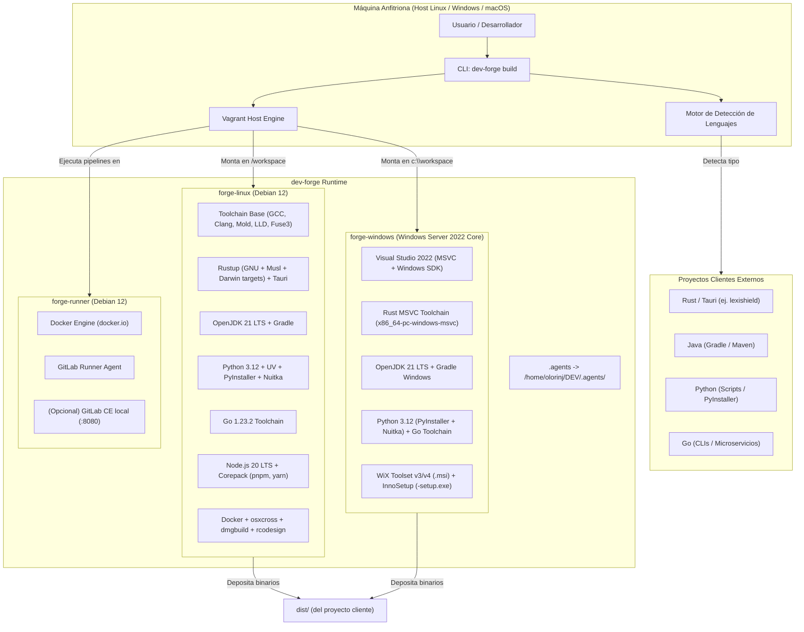
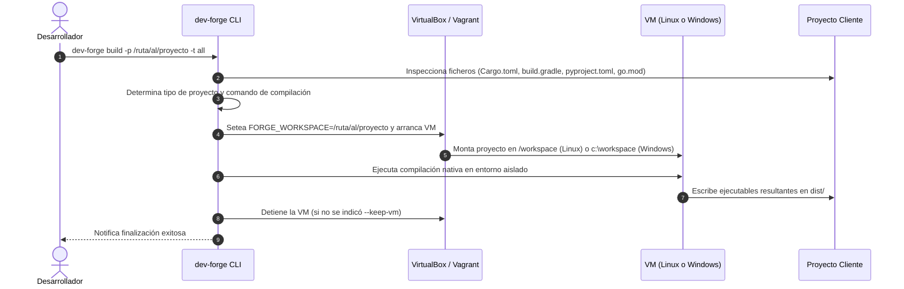

# Arquitectura del Sistema - `dev-forge`

`dev-forge` es una plataforma desacoplada de virtualización y compilación cruzada multi-lenguaje concebida para ejecutar compilaciones limpias e independientes del host (100% offline).

## 1. Diagrama de Arquitectura Global



---

## 2. Flujo de Compilación Desacoplada (100% Offline)



---

## 3. Principios de Aislamiento y Seguridad
1. **Host Inmutable**: La máquina host no requiere tener instalados compiladores de Windows, emuladores ni SDKs pesados.
2. **Cero Polución**: Las dependencias temporales y archivos intermedios de compilación se procesan dentro de la VM, manteniendo el proyecto cliente limpio.
3. **Persistencia de Bóveda y Agentes**: El enlace simbólico a `.agents` asegura el cumplimiento de las directrices y estándares universales del ecosistema.

---

## 4. Optimizaciones de Rendimiento y Virtualización

Para garantizar compilaciones a máxima velocidad de I/O y red, la arquitectura incorpora los siguientes mecanismos:

### 4.1 VirtIO Networking
- En la máquina Linux (`forge-linux`), la tarjeta de red NAT principal está configurada con `--nictype1 virtio`.
- Esto reduce drásticamente la sobrecarga de interrupciones del kernel emuladas y acelera la descarga de dependencias externas (crates de crates.io, paquetes npm, módulos Go).

### 4.2 Host I/O Cache en Controladoras SATA
- Las controladoras de almacenamiento SATA tanto en `forge-linux` (`SATA Controller`) como en `forge-windows` (`SATA`) tienen activado `--hostiocache on`.
- Permite que VirtualBox aproveche la memoria RAM y la caché del sistema operativo anfitrión para operaciones asíncronas de lectura/escritura en disco.

### 4.3 Desacoplamiento de Build Target del Sistema Compartido (`vboxsf`)
- Las carpetas compartidas de VirtualBox (`vboxsf`) sufren de alta latencia y contención de bloqueos con miles de archivos pequeños temporales (como los generados por `cargo` o `npm`).
- `dev-forge` redirige automáticamente los directorios de compilación a los sistemas de archivos nativos de cada máquina virtual:
  - **Linux**: `CARGO_TARGET_DIR=/tmp/cargo-target` (en disco rápido ext4 con linker ultrarrápido `mold`).
  - **Windows**: `CARGO_TARGET_DIR=C:\target` (en disco nativo NTFS).
- Al finalizar la compilación, únicamente los binarios y librerías finales (`.exe`, `.dll`, ejecutables ELF, `.so`) son copiados al directorio `dist/` montado en el host.

### 4.4 Empaquetado Automático y Vinculación Universal de Iconos (Windows)
- Tras depositar los ejecutables en `dist/`, el script [`provision/windows/package-artifacts.ps1`](../provision/windows/package-artifacts.ps1) se dispara automáticamente:
  - **Detección de Iconos**: Busca `.ico` en rutas estándar (`assets/`, `icons/`, `src-tauri/icons/`, `resources/`, raíz). Si solo existe un `.png`, ejecuta [`provision/windows/convert-icon.py`](../provision/windows/convert-icon.py) para generar un `.ico` multi-capa (`16x16` a `256x256`) sin intervención del usuario.
  - **Inno Setup (`<app>-setup.exe`)**: Genera el manifiesto `.iss`, compila con `ISCC.exe`, aplica `SetupIconFile`, instala el `.ico` en `{app}` y asocia los accesos directos.
  - **WiX Toolset (`<app>.msi`)**: Genera el archivo `.wxs` con GUIDs deterministas, compila con `candle.exe` y enlaza con `light.exe -sval -spdb`, registrando la propiedad `ARPPRODUCTICON` para el panel de desinstalación de Windows y accesos directos.
  - **Compiladores (PyInstaller)**: Inyecta dinámicamente `--icon <ruta_ico>` en la generación del binario principal.

### 4.5 Clones Enlazados (`linked_clone = true`) para Ahorro de Disco e Instanciación en Segundos
- Ambas máquinas virtuales (`forge-linux` y `forge-windows`) tienen habilitada la directiva `vb.linked_clone = true` en el `Vagrantfile`.
- En lugar de clonar un disco virtual completo de 25-30 GB para cada VM, VirtualBox crea discos diferenciales copy-on-write basados en la imagen maestra (`base box`).
- **Beneficios**:
  - Tiempo de creación o recreación de la máquina virtual reducido de 5-10 minutos a $<10$ segundos.
  - Ocupación en disco reducida de ~25 GB a ~2-3 GB por máquina virtual.

### 4.6 Caché Persistente de Compiladores en el Host (`~/.dev-forge/cache`)
- Para evitar descargas repetitivas de paquetes y módulos de terceros entre compilaciones de diferentes proyectos o reinicios de máquinas virtuales, `dev-forge` monta `~/.dev-forge/cache` como volumen compartido:
  - **Linux**: Montado en `/forge-cache` (`CARGO_HOME=/forge-cache/cargo`, `GOMODCACHE=/forge-cache/go/pkg/mod`, `PIP_CACHE_DIR=/forge-cache/pip`, `GRADLE_USER_HOME=/forge-cache/gradle`).
  - **Windows**: Montado en `C:\forge-cache`.
- Los artefactos intermedios activos permanecen aislados en discos rápidos locales (`/tmp/cargo-target`, `C:\target`) para evitar bloqueos de red `vboxsf`, mientras que las descargas de paquetes se benefician de la persistencia en el host.
- El usuario puede purgar la caché en cualquier momento mediante `dev-forge clean-cache [--subsystem <nombre>]`.

### 4.7 Bypass de FUSE para AppImages y Bundles de Tauri en Linux Headless
- En compilaciones para Linux (`forge-linux`), el empaquetado de Tauri invoca internamente `linuxdeploy` para generar paquetes `.AppImage`. Dado que `linuxdeploy` es a su vez un ejecutable AppImage, su ejecución en entornos virtualizados headless o contenedores falla si requiere montar `/dev/fuse`.
- `dev-forge` inyecta automáticamente:
  - `export APPIMAGE_EXTRACT_AND_RUN=1`: Fuerza a los AppImages a auto-extraerse en `/tmp` y ejecutarse directamente sin requerir llamadas al sistema de montaje FUSE.
  - `export NO_STRIP=1`: Previene fallos de stripping en bibliotecas compartidas complejas empaquetadas por `linuxdeploy`.
- **Recolección Multi-Ruta de Bundles**: Debido al aislamiento en `/tmp/cargo-target`, Tauri genera los paquetes en `/tmp/cargo-target/release/bundle/`. El recolector de `dev-forge` escanea recursivamente tanto `/tmp/cargo-target/release/bundle/` como `src-tauri/target/release/bundle/` y copia todos los paquetes `.deb`, `.rpm` y `.AppImage` hacia `/workspace/dist/`.

### 4.8 Sanitización Determinista de Versiones Semver para WiX Toolset
- Las especificaciones del instalador de Windows (MSI) y de WiX Toolset exigen estrictamente números enteros en formato `Major.Minor.Build` (`Major <= 255`, `Minor <= 255`, `Build <= 65535`). Las etiquetas Semver convencionales (ej. `2.0.1-beta.1` o `1.0.0+build.42`) provocan fallos de sintaxis en `candle.exe`.
- `dev-forge` incorpora un motor de sanitización de versión:
  - Extrae la versión del manifiesto (`Cargo.toml`, `pyproject.toml`, `package.json`) o del árbol Git (`git describe --tags`).
  - Limpia y formatea los 3 componentes enteros requeridos por WiX (ej. `2.0.1`), asegurando la validez del MSI.
  - Conserva la versión semver completa en los nombres de archivo y en la metadata amigable de Inno Setup (`AppVersion`).

### 4.9 Compilación C Ahead-of-Time con Nuitka para Python (Anti-EDR/Antivirus)
- Los empaquetadores basados en cargadores ejecutables (como PyInstaller) empaquetan el runtime de Python y el bytecode comprimido, lo que a menudo dispara falsas alarmas heurísticas en motores antivirus y soluciones EDR corporativas en Windows.
- `dev-forge` soporta compilación mediante Nuitka (`--compiler nuitka`):
  - Transpila el código fuente Python a código C nativo y lo compila con GCC (Linux) o MSVC (Windows).
  - Produce ejecutables totalmente autónomos (`--standalone --onefile`) de arranque instantáneo y resistentes a bloqueos heurísticos.

### 4.10 Descubrimiento Dinámico de Ejecutables GUI y Recolección Multi-Directorio en Windows
- En proyectos de interfaz de usuario de escritorio basados en Tauri (Tauri v1 y v2), el ejecutable final en Windows adopta el nombre especificado en `productName` de `tauri.conf.json` (por ejemplo, `LexiShield.exe`), el cual difiere comúnmente del nombre del crate en `src-tauri/Cargo.toml` (`lexishield-gui`).
- Para eliminar la fragilidad de nombres cableados, `dev-forge` implementa un motor de búsqueda dinámica en PowerShell:
  - Inspecciona las rutas candidatas (`C:\target\release`, `src-tauri\target\release`, `target\release`), filtrando ejecutables que no correspondan a dependencias intermedias (`deps`, `build`, `incremental`) ni al CLI.
  - Genera las copias canónicas (`<app>-gui-windows.x86_64.exe`) y versionadas (`<app>-gui-<version>-windows.x86_64.exe`).
  - Recolecta automáticamente los instaladores y paquetes producidos por Tauri en cualquiera de las tres posibles ubicaciones de bundle hacia `/workspace/dist/`.

### 4.11 Aislamiento de Entorno Vagrant y Operación Fuera del Árbol (`VAGRANT_DOTFILE_PATH`)
- Cuando `dev-forge` se ejecuta desde cualquier directorio del sistema host (fuera del repositorio de la forja), Vagrant podría intentar buscar o crear su directorio de estado `.vagrant/` dentro del directorio de trabajo actual del cliente.
- `dev-forge` previene esto forzando en todas sus llamadas:
  - `VAGRANT_CWD`: Apunta permanentemente a la ruta canónica de la forja.
  - `VAGRANT_DOTFILE_PATH`: Apunta estrictamente a `<forge-root>/.vagrant`, asegurando que el estado de las máquinas virtuales sea compartido globalmente y que jamás se contamine el repositorio del usuario.

### 4.12 Staging Efímero de Frontends en Windows Guests (`$env:TEMP\build_ui`)
- Las carpetas compartidas de VirtualBox (`vboxsf` en Windows: `\\VBoxSvr\workspace`) sufren fallos graves de concurrencia, permisos de sockets y enlaces simbólicos cuando empaquetadores basados en Node (como Vite, esbuild o Rollup) ejecutan `npm run build`.
- Para garantizar compilaciones deterministas de aplicaciones web embebidas (ej. interfaces de Tauri), `dev-forge`:
  1. Clona el directorio del frontend (`ui/` o `frontend/`) a almacenamiento volátil nativo del guest (`$env:TEMP\build_ui`).
  2. Ejecuta `npm run build` en el disco local rápido.
  3. Sincroniza la carpeta compilada resultante (`dist/`) de vuelta al workspace compartido antes de que `cargo` o el compilador anfitrión ensamble el binario final.
- Durante la compilación de GUIs de Tauri en Windows se exporta `$env:DISABLE_WINRES = '1'` para evitar conflictos de símbolos duplicados entre bibliotecas de terceros y `tauri-build`.

### 4.13 Invariante Criptográfico Anti-Colisión (CLI vs GUI por Hash SHA-256)
- En proyectos que combinan CLI y GUI en el mismo repositorio (arquitectura multi-crate como Tauri v2), una recolección heurística de ejecutables `.exe` puede capturar accidentalmente el binario CLI y renombrarlo como GUI, generando ejecutables que abren una consola y terminan de inmediato.
- `dev-forge` aplica un invariante criptográfico estricto:
  1. Calcula el hash SHA-256 del binario CLI recién compilado.
  2. Verifica que todo ejecutable cosechado como GUI o incluido en instaladores (WiX MSI / Inno Setup) tenga un nombre diferente y un hash SHA-256 estrictamente distinto al CLI.
  3. Si no existe un binario GUI genuino, la compilación falla de inmediato con código de salida 1 en lugar de emitir artefactos defectuosos.

### 4.14 Fallback de Compilación Cruzada macOS mediante Contenedor `osxcross`
- Para compilar aplicaciones hacia Darwin (`x86_64-apple-darwin` y `aarch64-apple-darwin`) de forma 100% desatendida y sin hardware Apple físico:
  - Si el proyecto no provee su propio Dockerfile, `dev-forge` genera al vuelo un Dockerfile multi-stage basado en `crazymax/osxcross:latest-ubuntu` y `rust:latest`.
  - Configura los enlaces simbólicos `o64-clang` y `oa64-clang` en el entorno Linux y compila ambos destinos depositando los binarios Mach-O en `dist/`.

### 4.15 Detección y Propagación de Versiones desde Ramas Git
- Cuando un manifiesto cliente define una versión genérica o por defecto (`0.1.0`), `dev-forge` inspecciona la rama Git activa (`git branch --show-current`).
- Si la rama sigue patrones de release (`feature/v2.0.1`, `release/2.0.1`, etc.), extrae la versión semver (`2.0.1`) y la sincroniza dinámicamente con los nombres de archivo y con el sanitizador de 3 dígitos enteros de WiX Toolset para garantizar la integridad del MSI.

---

## 5. Ergonomía del Entorno y Estabilidad Operativa

### 5.1 Cuotas de Memoria WinRM en Windows
- Por defecto, WinRM impone un límite estricto de memoria (`MaxMemoryPerShellMB = 512-1024 MB`), lo cual provoca bloqueos de conexión o fallos silenciosos durante compilaciones exigentes de MSVC o C++ nativo.
- El aprovisionamiento de `dev-forge` eleva automáticamente esta cuota a 8192 MB:
  ```powershell
  Set-Item WSMan:\localhost\Shell\MaxMemoryPerShellMB -Value 8192 -Force
  ```

### 5.2 Prevención de Latencia en Prompts Modernos (Starship)
- Shells con prompts interactivos (como [Starship](https://starship.rs)) disponen de un módulo `vagrant` que consulta `vagrant status` al ingresar en cualquier directorio que contenga un `Vagrantfile`. Esto introduce una molesta latencia de 1 a 2 segundos por comando.
- Se recomienda desactivar este módulo en la configuración del host (`~/.config/starship.toml`):
  ```toml
  [vagrant]
  disabled = true
  ```

### 5.3 Localización y Teclado Dinámico Host-to-Guest
- Tanto la máquina Linux (`forge-linux`) como la de Windows (`forge-windows`) detectan automáticamente en tiempo de ejecución la distribución de teclado y configuración regional de la máquina anfitriona (host):
  - **Detección Host**: En Linux anfitrión inspecciona `localectl`, `/etc/default/keyboard`, `setxkbmap` y `$LANG`. En Windows anfitrión consulta `Get-WinUserLanguageList` y `CultureInfo`.
  - **Mapeo Biyectivo**: Normaliza el código de distribución (ej. `es`, `us`, `fr`, `de`, `latam`) y lo traduce al identificador de consola Linux (ej. `es`) y a la etiqueta BCP-47 de Windows (ej. `es-ES`, `en-US`, `fr-FR`).
  - **Aprovisionamiento**: Se inyecta como parámetro en los scripts de aprovisionamiento base (`00-base.sh` en Linux y `00-base.ps1` en Windows), garantizando una experiencia de teclado 100% fiel al host físico del desarrollador sin mapeos manuales.

### 5.4 Entornos de Desarrollo Remoto con VS Code (`dev-forge ide`)
- Para desarrolladores que prefieren programar directamente dentro del entorno virtualizado (con todas las herramientas y bibliotecas nativas preinstaladas), el CLI ofrece el comando:
  ```bash
  dev-forge ide setup-vscode --project /ruta/a/mi-proyecto --profile rust
  ```
- **Capacidades**:
  - Extrae automáticamente la configuración SSH activa de la máquina virtual (`vagrant ssh-config`).
  - Genera dentro del proyecto la carpeta `.vscode/` con `launch.json`, `tasks.json`, `settings.json` y recomendaciones de extensiones adaptadas al lenguaje (`rust`, `python`, `go`, `java`, `c`).
  - Permite abrir VS Code y conectarse transparentemente a `forge-linux` usando la extensión *Remote - SSH*.

### 5.5 Ergonomía Global del CLI y Selección Interactiva de Proyectos
- **Instalación no intrusiva en `~/.local/bin`**: El comando `dev-forge install-bin` (invocado también de forma transparente durante `dev-forge tune`) genera un enlace simbólico en el directorio estándar de usuario `~/.local/bin/dev-forge`, permitiendo que el comando esté disponible de forma global en cualquier terminal sin requerir elevación de privilegios `root` ni contaminar `/usr/local/bin`.
- **Asistente Inteligente de Selección de Proyectos**:
  - Al ejecutar `dev-forge build` sin indicar explícitamente el flag `--project` / `-p`, el asistente verifica si el directorio de trabajo actual contiene un manifiesto de desarrollo válido (`Cargo.toml`, `pyproject.toml`, `CMakeLists.txt`, `go.mod`, etc.).
  - Si se ejecuta desde un directorio neutro (por ejemplo `~` o `/tmp`), presenta un selector interactivo con los últimos 5 proyectos utilizados (persistidos en `~/.dev-forge/recent_projects.json`) y la posibilidad de ingresar una ruta manual con soporte nativo para expansión de tilde `~`.


### 5.6 Orquestación Aislada de CI/CD Runners (`dev-forge runner`)
- Para proyectos que requieren verificación de pipelines de integración continua (como `.gitlab-ci.yml`), DevForge encapsula la ejecución en una máquina virtual dedicada basada en Bento Debian 12 con Docker daemon y `gitlab-runner`.
- **Aislamiento Total**: Evita la ejecución de scripts no verificados o contaminantes en el host de desarrollo y elimina la dependencia de runners compartidos en la nube.
- **Modo 100% Offline**: Permite instanciar un servidor GitLab Community Edition (CE) local en contenedor, facilitando la validación completa de pipelines antes de realizar publicaciones remotas.
- Para más información técnica y arquitectura detallada, consultar [`docs/gitlab-ci-runner.md`](gitlab-ci-runner.md).

### 5.7 Ergonomía de Terminal y Mitigación de Latencia Starship Prompt
- La presencia de ficheros `Vagrantfile` en la raíz de los repositorios cliente provoca que prompts modernos como [Starship](https://starship.rs/) intenten consultar la versión de Vagrant (`vagrant --version`), la cual demora entre 1.5s y 2.0s por la carga del runtime de Ruby. Esto supera el timeout predeterminado de Starship (500ms), produciendo advertencias molestas y bloqueos de interfaz en la terminal.
- **Solución Arquitectónica de DevForge**: Al centralizar los entornos de compilación fuera del árbol de directorios de los proyectos cliente (`out-of-tree` con `VAGRANT_CWD` y `VAGRANT_DOTFILE_PATH`), los repositorios permanecen 100% limpios de metadatos de Vagrant, garantizando una respuesta instantánea y sin alertas en la consola del desarrollador.

### 5.8 Despliegue Instantáneo con Custom Boxes VDI Pre-compiladas
- Para eliminar la penalización temporal de aprovisionamiento en cada nueva máquina (donde descargar e instalar toolchains puede demorar decenas de minutos), DevForge soporta **Custom Boxes VDI** pre-compiladas y selladas.
- **Arquitectura de Dos Capas**:
  1. **Base Box Sellada (VDI Compacto)**: Aloja todos los toolchains de compilación (Rust, Go, Node, Java, MSVC, WiX), con servicios innecesarios deshabilitados (`bluetooth`, `cups`, `WSearch`, telemetría), bloqueo absoluto de actualizaciones automáticas (`apt-daily`, `wuauserv`) y purga de kernels antiguos manteniendo estrictamente un único kernel activo.
  2. **Playbooks Declarativos en Git**: La fuente de la verdad para añadir nuevos lenguajes permanece en `provision/ansible/`. Prototipar un nuevo lenguaje tarda 1-2 minutos con `dev-forge provision`, y cuando se valida, se sella una nueva versión de la box con `dev-forge box package`.
- **Formato VDI Nativo**: Al utilizar discos `.vdi` en lugar de `.vmdk`, VirtualBox aprovecha la compactación por bloques vacíos (`modifymedium --compact`), reduciendo el tamaño de transferencia y acelerando la lectura/escritura en disco.
- Para consultar el manual completo, comandos del CLI y linaje upstream, consultar [`docs/vagrant-boxes-guide.md`](vagrant-boxes-guide.md).
