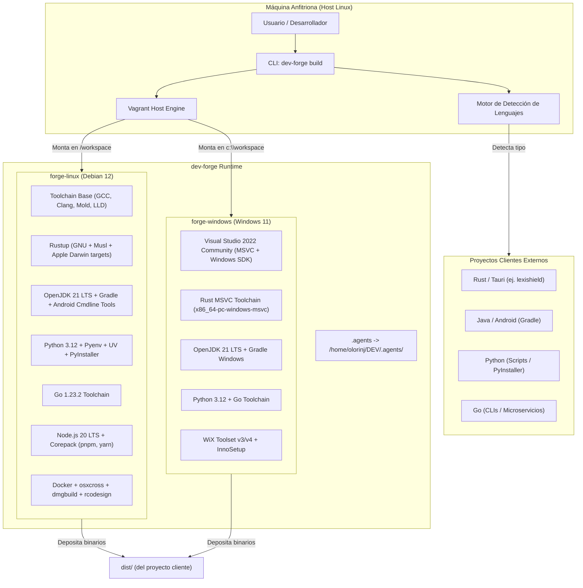
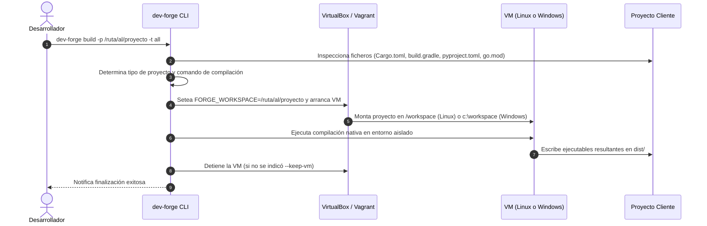

# Arquitectura del Sistema - `dev-forge`

`dev-forge` es una plataforma desacoplada de virtualización y compilación cruzada multi-lenguaje concebida para ejecutar compilaciones limpias e independientes del host (Modo B offline).

## 1. Diagrama de Arquitectura Global

---

## 2. Flujo de Compilación Desacoplada (Modo B)

---

## 3. Principios de Aislamiento y Seguridad
1. **Host Inmutable**: La máquina host no requiere tener instalados compiladores de Windows, emuladores ni SDKs pesados.
2. **Cero Polución**: Las dependencias temporales y archivos intermedios de compilación se procesan dentro de la VM, manteniendo el proyecto cliente limpio.
3. **Persistencia de Bóveda y Agentes**: El enlace simbólico a `.agents` asegura el cumplimiento de las directrices y estándares universales del ecosistema.

