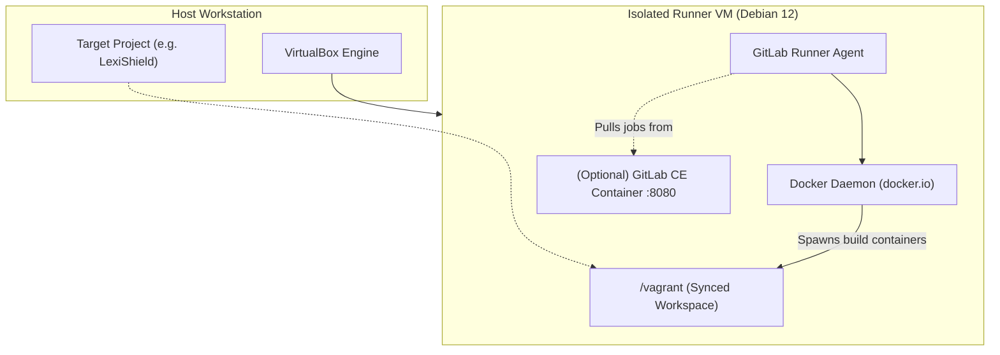

# Isolated CI/CD Runner Orchestration (GitLab CI/CD)

This document specifies the architecture and operational procedures for provisioning and executing isolated, reproducible CI/CD pipelines using dedicated guest virtual machines (Bento Debian 12 + Docker) and GitLab Runner.

---

## 1. Architectural Overview

Running complex build and test pipelines on host systems or public shared runners presents significant trade-offs:
- **Shared Runner Limits**: Public runners often incur minute quotas, lack specialized hypervisor extensions, or expose proprietary code to multi-tenant cloud infrastructure.
- **Host Contamination**: Running raw CI scripts locally risks polluting host environments with build packages, orphaned containers, and conflicting system libraries.

DevForge provides a dedicated, fully isolated runner environment encapsulated in a Bento Debian 12 VirtualBox guest:
- **Base OS**: `bento/debian-12` (Bookworm).
- **Compute Sizing**: 4 vCPUs, 4096 MB RAM, 2048 MB Swap disk file.
- **Container Engine**: Native `docker.io` daemon managed via systemd.
- **Runner Agent**: Official GitLab Runner (`gitlab-runner`) preconfigured with the Docker executor.
- **Optional Local GitLab Server**: On-demand containerized GitLab Community Edition (CE) for 100% offline development.



---

## 2. Vagrant Provisioning Specification

The runner VM configuration leverages hardware virtualization acceleration and secure daemon permissions:

```ruby
Vagrant.configure("2") do |config|
  config.vm.box = "bento/debian-12"
  config.vm.synced_folder ".", "/vagrant", mount_options: ["dmode=775", "fmode=775"]

  # Port forwardings for local GitLab CE
  config.vm.network "forwarded_port", guest: 80, host: 8080, auto_correct: true
  config.vm.network "forwarded_port", guest: 443, host: 8443, auto_correct: true

  config.vm.provider "virtualbox" do |vb|
    vb.name = "devforge-gitlab-runner"
    vb.memory = "4096"
    vb.cpus = 4
    vb.customize ["modifyvm", :id, "--ioapic", "on"]
    vb.customize ["modifyvm", :id, "--paravirtprovider", "kvm"]
    vb.customize ["modifyvm", :id, "--nested-hw-virt", "on"]
    vb.customize ["modifyvm", :id, "--natdnshostresolver1", "on"]
    vb.customize ["modifyvm", :id, "--audio", "none"]
    vb.customize ["modifyvm", :id, "--vram", "16"]
    vb.customize ["modifyvm", :id, "--accelerate3d", "off"]
  end

  config.vm.provision "shell", inline: <<-SHELL
    export DEBIAN_FRONTEND=noninteractive

    # 1. 2GB Swapfile for memory-intensive compiler passes
    if [ ! -f /swapfile ]; then
      fallocate -l 2G /swapfile
      chmod 600 /swapfile
      mkswap /swapfile
      swapon /swapfile
      echo '/swapfile none swap sw 0 0' >> /etc/fstab
    fi

    # 2. System updates and base tools
    apt-get update
    apt-get install -y --no-install-recommends \
      curl ca-certificates gnupg lsb-release git docker.io build-essential pkg-config libssl-dev

    # 3. Docker service activation
    systemctl enable --now docker
    usermod -aG docker vagrant

    # 4. GitLab Runner installation
    curl -L --retry 3 --retry-delay 2 "https://packages.gitlab.com/install/repositories/runner/gitlab-runner/script.deb.sh" | bash
    apt-get install -y gitlab-runner
    usermod -aG docker gitlab-runner
    systemctl enable --now gitlab-runner

    # 5. Helper utility: register-runner
    cat << 'EOF_REG' > /usr/local/bin/register-runner
#!/bin/bash
if [ -z "$1" ]; then
  echo "Usage: register-runner <GITLAB_TOKEN> [GITLAB_URL (default: https://gitlab.com)]"
  exit 1
fi
TOKEN="$1"
URL="${2:-https://gitlab.com}"
sudo gitlab-runner register \
  --non-interactive \
  --url "$URL" \
  --token "$TOKEN" \
  --executor "docker" \
  --docker-image "rust:1.85-slim" \
  --docker-volumes "/var/run/docker.sock:/var/run/docker.sock" \
  --description "devforge-bento-debian12-runner" \
  --tag-list "rust,docker,linux"
echo "Runner successfully registered!"
EOF_REG
    chmod +x /usr/local/bin/register-runner

    # 6. Helper utility: start-gitlab-server (Offline testing)
    cat << 'EOF_GL' > /usr/local/bin/start-gitlab-server
#!/bin/bash
docker run --detach \
  --hostname localhost \
  --publish 80:80 --publish 443:443 --publish 2222:22 \
  --name gitlab \
  --restart always \
  --volume /srv/gitlab/config:/etc/gitlab \
  --volume /srv/gitlab/logs:/var/log/gitlab \
  --volume /srv/gitlab/data:/var/opt/gitlab \
  --shm-size 256m \
  gitlab/gitlab-ce:latest
echo "GitLab CE starting. Access at http://localhost:8080"
echo "Root initial password: sudo docker exec -it gitlab grep 'Password:' /etc/gitlab/initial_root_password"
EOF_GL
    chmod +x /usr/local/bin/start-gitlab-server
  SHELL
end
```

---

## 3. Operational Workflows

### Managing the Runner via dev-forge CLI

DevForge provides dedicated subcommands to manage the runner lifecycle from the host:

```bash
# Boot the isolated runner VM
dev-forge runner up

# Check status
dev-forge runner status

# Interactive SSH session
dev-forge runner ssh

# Register with GitLab instance
dev-forge runner register <REGISTRATION_TOKEN> [https://gitlab.example.com]

# Start offline local GitLab CE server (:8080)
dev-forge runner start-gitlab

# Halt runner to release host RAM
dev-forge runner halt
```

### Registering with a Remote Project
1. Obtain the registration token from GitLab (**Settings $\rightarrow$ CI/CD $\rightarrow$ Runners**).
2. Register the runner using the DevForge CLI:
   ```bash
   dev-forge runner register <REGISTRATION_TOKEN> [https://gitlab.example.com]
   ```
   Or directly inside the VM:
   ```bash
   dev-forge runner ssh -c "sudo register-runner <REGISTRATION_TOKEN> [https://gitlab.example.com]"
   ```

### 100% Offline Air-Gapped Operation
To test pipelines completely offline:
1. Start the containerized GitLab Community Edition server:
   ```bash
   dev-forge runner start-gitlab
   ```
2. Navigate to `http://localhost:8080` on the host machine.
3. Retrieve root credentials:
   ```bash
   dev-forge runner ssh -c "sudo docker exec -it gitlab grep 'Password:' /etc/gitlab/initial_root_password"
   ```
4. Push project repositories to the local instance and link the runner via `http://localhost`.

---

## 4. Resource Teardown and Lifecycle Management
* **Clean Shutdown**:
  ```bash
  dev-forge runner halt
  ```
* **Vagrant Direct Control**:
  ```bash
  vagrant halt forge-runner
  vagrant destroy -f forge-runner
  ```
