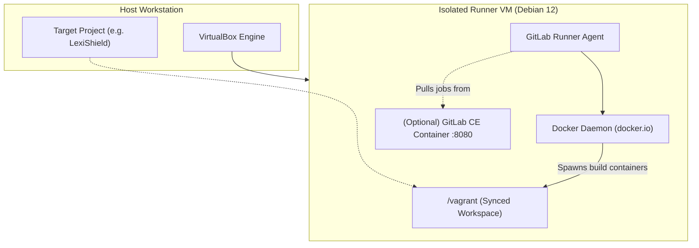

# Orquestación de ejecutores de CI/CD aislados (GitLab CI/CD)

Este documento describe la arquitectura y los procedimientos operativos para aprovisionar y ejecutar canalizaciones de CI/CD aisladas y reproducibles mediante máquinas virtuales dedicadas (Bento Debian 12 con Docker) y GitLab Runner.

---

## 1. Visión general de la arquitectura

Ejecutar flujos complejos de compilación y pruebas directamente en la máquina anfitriona o en ejecutores públicos compartidos plantea compromisos importantes:
- **Límites en runners compartidos**: Los ejecutores públicos suelen imponer cuotas por minuto, carecen de extensiones especializadas del hipervisor o exponen código propietario en infraestructuras multitenant en la nube.
- **Contaminación del anfitrión**: Ejecutar scripts de CI en local puede ensuciar el entorno de desarrollo con paquetes residuales, contenedores huérfanos y librerías del sistema incompatibles.

DevForge proporciona un entorno de ejecución dedicado y completamente aislado dentro de una máquina virtual VirtualBox con Debian 12:
- **Sistema base**: `bento/debian-12` (Bookworm).
- **Recursos**: 4 vCPUs, 4096 MB RAM, archivo swap de 2048 MB.
- **Motor de contenedores**: Demonio nativo `docker.io` gestionado mediante systemd.
- **Agente de ejecución**: GitLab Runner oficial (`gitlab-runner`) preconfigurado con el ejecutor de Docker.
- **Servidor GitLab local (opcional)**: Contenedor bajo demanda con GitLab Community Edition (CE) para desarrollo y pruebas 100% desconectadas de internet.



---

## 2. Especificación del aprovisionamiento en Vagrant

The runner VM configuration leverages hardware virtualization acceleration and secure daemon permissions:

```ruby
Vagrant.configure("2") do |config|
  config.vm.box = "bento/debian-12"
  config.vm.synced_folder ".", "/vagrant", mount_options: ["dmode=775", "fmode=775"]

  # Port forwardings for local GitLab CE
  config.vm.network "forwarded_port", guest: 80, host: 8080, auto_correct: true
  config.vm.network "forwarded_port", guest: 443, host: 8443, auto_correct: true

  config.vm.provider "virtualbox" do |vb|
    vb.name = "devforge-gitlab-runner"
    vb.memory = "4096"
    vb.cpus = 4
    vb.customize ["modifyvm", :id, "--ioapic", "on"]
    vb.customize ["modifyvm", :id, "--paravirtprovider", "kvm"]
    vb.customize ["modifyvm", :id, "--nested-hw-virt", "on"]
    vb.customize ["modifyvm", :id, "--natdnshostresolver1", "on"]
    vb.customize ["modifyvm", :id, "--audio", "none"]
    vb.customize ["modifyvm", :id, "--vram", "16"]
    vb.customize ["modifyvm", :id, "--accelerate3d", "off"]
  end

  config.vm.provision "shell", inline: <<-SHELL
    export DEBIAN_FRONTEND=noninteractive

    # 1. 2GB Swapfile for memory-intensive compiler passes
    if [ ! -f /swapfile ]; then
      fallocate -l 2G /swapfile
      chmod 600 /swapfile
      mkswap /swapfile
      swapon /swapfile
      echo '/swapfile none swap sw 0 0' >> /etc/fstab
    fi

    # 2. System updates and base tools
    apt-get update
    apt-get install -y --no-install-recommends \
      curl ca-certificates gnupg lsb-release git docker.io build-essential pkg-config libssl-dev

    # 3. Docker service activation
    systemctl enable --now docker
    usermod -aG docker vagrant

    # 4. GitLab Runner installation
    curl -L --retry 3 --retry-delay 2 "https://packages.gitlab.com/install/repositories/runner/gitlab-runner/script.deb.sh" | bash
    apt-get install -y gitlab-runner
    usermod -aG docker gitlab-runner
    systemctl enable --now gitlab-runner

    # 5. Helper utility: register-runner
    cat << 'EOF_REG' > /usr/local/bin/register-runner
#!/bin/bash
if [ -z "$1" ]; then
  echo "Usage: register-runner <GITLAB_TOKEN> [GITLAB_URL (default: https://gitlab.com)]"
  exit 1
fi
TOKEN="$1"
URL="${2:-https://gitlab.com}"
sudo gitlab-runner register \
  --non-interactive \
  --url "$URL" \
  --token "$TOKEN" \
  --executor "docker" \
  --docker-image "rust:1.85-slim" \
  --docker-volumes "/var/run/docker.sock:/var/run/docker.sock" \
  --description "devforge-bento-debian12-runner" \
  --tag-list "rust,docker,linux"
echo "Runner successfully registered!"
EOF_REG
    chmod +x /usr/local/bin/register-runner

    # 6. Helper utility: start-gitlab-server (Offline testing)
    cat << 'EOF_GL' > /usr/local/bin/start-gitlab-server
#!/bin/bash
docker run --detach \
  --hostname localhost \
  --publish 80:80 --publish 443:443 --publish 2222:22 \
  --name gitlab \
  --restart always \
  --volume /srv/gitlab/config:/etc/gitlab \
  --volume /srv/gitlab/logs:/var/log/gitlab \
  --volume /srv/gitlab/data:/var/opt/gitlab \
  --shm-size 256m \
  gitlab/gitlab-ce:latest
echo "GitLab CE starting. Access at http://localhost:8080"
echo "Root initial password: sudo docker exec -it gitlab grep 'Password:' /etc/gitlab/initial_root_password"
EOF_GL
    chmod +x /usr/local/bin/start-gitlab-server
  SHELL
end
```

---

## 3. Flujos operativos de trabajo

### Gestión del ejecutor mediante la CLI de dev-forge

DevForge ofrece comandos dedicados para gestionar el ciclo de vida del runner desde el anfitrión:

```bash
# Iniciar la máquina virtual del runner
dev-forge runner up

# Comprobar el estado
dev-forge runner status

# Sesión SSH interactiva
dev-forge runner ssh

# Registrar el runner en GitLab
dev-forge runner register <REGISTRATION_TOKEN> [https://gitlab.example.com]

# Iniciar servidor local de GitLab CE (:8080)
dev-forge runner start-gitlab

# Detener el runner para liberar RAM en el host
dev-forge runner halt
```

### Registro con un proyecto remoto
1. Obtén el token de registro en GitLab (**Settings $\rightarrow$ CI/CD $\rightarrow$ Runners**).
2. Registra el ejecutor mediante la CLI de DevForge:
   ```bash
   dev-forge runner register <REGISTRATION_TOKEN> [https://gitlab.example.com]
   ```
   O directamente dentro de la máquina virtual:
   ```bash
   dev-forge runner ssh -c "sudo register-runner <REGISTRATION_TOKEN> [https://gitlab.example.com]"
   ```

### Operación 100% aislada y sin conexión a internet
Para probar canalizaciones de integración de forma totalmente offline:
1. Inicia el servidor GitLab Community Edition en contenedor:
   ```bash
   dev-forge runner start-gitlab
   ```
2. Accede a `http://localhost:8080` desde el navegador de la máquina host.
3. Obtén la contraseña inicial del usuario administrador (`root`):
   ```bash
   dev-forge runner ssh -c "sudo docker exec -it gitlab grep 'Password:' /etc/gitlab/initial_root_password"
   ```
4. Envía los repositorios del proyecto a la instancia local y enlaza el runner a través de `http://localhost`.

---

## 4. Desmantelamiento y gestión del ciclo de vida
* **Apagado limpio**:
  ```bash
  dev-forge runner halt
  ```
* **Control directo con Vagrant**:
  ```bash
  vagrant halt forge-runner
  vagrant destroy -f forge-runner
  ```
