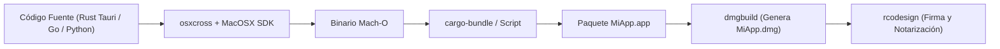

# Compilación y firmado de interfaces gráficas para macOS desde Linux

Este documento explica en detalle cómo `dev-forge` permite compilar aplicaciones completas con interfaz gráfica de usuario (GUI) en formatos `.app` y `.dmg` para macOS directamente desde la máquina virtual Linux, sin necesidad de disponer de hardware Apple físico.

---

## 1. Fundamentos técnicos del empaquetado para macOS

A diferencia de un ejecutable de Windows (`.exe`) o de Linux (ELF plano), una aplicación de macOS para el usuario final es un directorio estructurado (*bundle*):

```
MiApp.app/
├── Contents/
│   ├── Info.plist              # Metadatos, identificador del bundle, permisos
│   ├── MacOS/
│   │   └── MiApp               # Binario ejecutable Mach-O (x86_64 o arm64)
│   └── Resources/
│       ├── icon.icns           # Icono de la aplicación
│       └── Assets...           # Recursos estáticos o web de Tauri / Svelte
```

Dado que esta estructura es un estándar de carpetas y ficheros XML, **puede ser generada al 100% en cualquier sistema GNU/Linux**.

---

## 2. Componentes del flujo de trabajo en `dev-forge`



### 1. `osxcross`
Utiliza el compilador Clang de LLVM enlazando contra las cabeceras de sistema de macOS extraídas de Xcode (`MacOSX.sdk`), soportando frameworks esenciales:
- `Cocoa.framework`
- `WebKit.framework` (imprescindible para Tauri)
- `AppKit.framework`

### 2. `dmgbuild`
Herramienta en Python que permite construir imágenes `.dmg` estándar para macOS directamente desde Linux, permitiendo añadir fondos personalizados, iconos y el enlace simbólico hacia `/Applications`.

### 3. `rcodesign` (Apple Code Signing en Rust)
El mayor obstáculo en macOS es **Apple Gatekeeper**: el sistema operativo bloquea y envía a la papelera cualquier binario descargado de internet que no esté firmado y notarizado por Apple.

`dev-forge` incluye la herramienta `rcodesign` (desarrollada por Gregory Szorc):
- Permite firmar binarios Mach-O, bundles `.app` y archivos `.dmg` usando certificados criptográficos de Apple Developer (`.p12`).
- Permite **comunicarse con las APIs de Notarización de Apple directamente desde Linux** mediante credenciales de App Store Connect, obteniendo el *ticket* de aprobación de Apple sin tocar un Mac.

