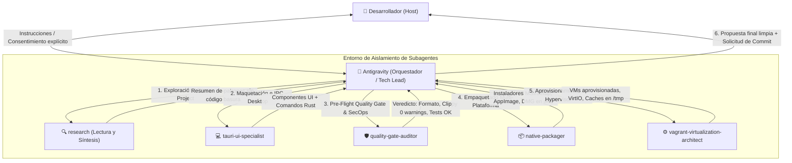
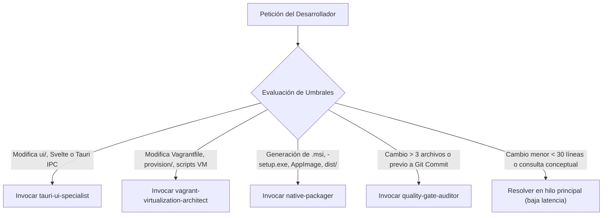
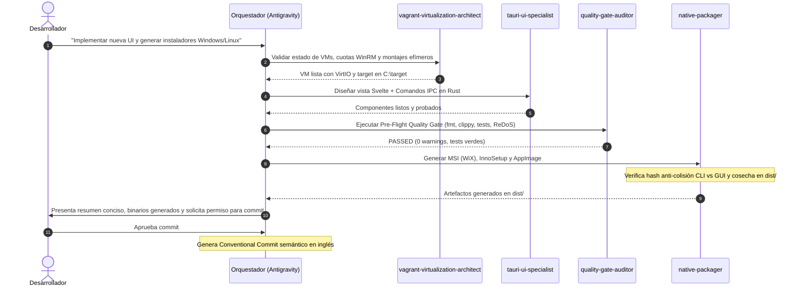

# Arquitectura y Flujo de Trabajo con Subagentes en `dev-forge`

Este documento describe la integración de **Subagentes Especializados** en el ecosistema `dev-forge`, materializando las directrices de [`AGENTS.md`](file:///home/olorinj/DEV/dev-forge/.agents/AGENTS.md) y los roles definidos en `.agents/roles/` dentro de un modelo de orquestación desacoplado.

---

## 1. Motivación y Principios

En proyectos con múltiples toolchains, compilación cruzada, interfaces gráficas de alto rendimiento (Tauri/egui) y estrictos estándares de seguridad, un modelo de agente monolítico presenta dos cuellos de botella críticos:

1. **Saturación de Contexto (Context Bloat)**: Las trazas de compiladores (`cargo clippy`, `rustc`, `VBoxManage`, WiX), tests masivos y análisis estáticos consumen rápidamente la ventana de contexto, provocando degradación en la fidelidad de seguimiento de reglas.
2. **Sesgo de Confirmación**: El mismo agente que escribe el código tiende a validar sus propios cambios con menor rigor crítico.

La arquitectura de subagentes resuelve esto dividiendo el trabajo en **un Orquestador (Tech Lead)** y **Especialistas de Ejecución y Auditoría Aislados**.

---

## 2. Catálogo de Subagentes Especializados

### 2.1. `tauri-ui-specialist`
* **Definición**: Especialista en desarrollo frontend y backend IPC para aplicaciones de escritorio Tauri (Rust + Svelte/Tailwind CSS/Vite).
* **Rol de referencia**: [tauri-ui-agent.md](file:///home/olorinj/DEV/dev-forge/.agents/roles/common/tauri-ui-agent.md).
* **Invariantes que supervisa**:
  - **Experiencia de Escritorio Nativa**: Barras de título personalizadas, zonas de arrastre (`data-tauri-drag-region`), anulación de menús contextuales de navegador innecesarios.
  - **Estética Moderna**: Layouts estilo Bento Box, translucidez sutil (glassmorphism), microinteracciones y filosofía *Dark Mode First*.
  - **Seguridad Zero-Trust**: Validación estricta en Rust de todo payload proveniente del frontend; prohibición de `eval()` o scripts remotos.
  - **Simetría y Feedback**: En interfaces bidireccionales (ej. cifrado/descifrado, ofuscación), garantiza señales de completado equivalentes (toasts con conteo de elementos y tiempo en ms).

### 2.2. `quality-gate-auditor`
* **Definición**: Auditor estricto de QA, Seguridad, ReDoS y Pre-Flight Quality Gate.
* **Roles de referencia**: [quality-gate-auditor.md](file:///home/olorinj/DEV/dev-forge/.agents/roles/common/quality-gate-auditor.md), [security-auditor.md](file:///home/olorinj/DEV/dev-forge/.agents/roles/common/security-auditor.md) y [qa-fuzzer.md](file:///home/olorinj/DEV/dev-forge/.agents/roles/common/qa-fuzzer.md).
* **Invariantes que supervisa**:
  - **Pre-Flight Quality Gate (Mandatorio)**:
    1. *Formatting*: `cargo fmt --all -- --check` / `ruff format --check .`.
    2. *Strict Linting*: Cero errores y cero advertencias (`cargo clippy --all-targets --all-features -- -D warnings`). Verificación de `#![warn(clippy::pedantic)]`.
    3. *Zero Regression*: Ejecución de suites de prueba (`cargo test -q`) con 100% de éxito.
    4. *Diff Verification*: Inspección de `git diff` para evitar cambios espurios.
  - **Cero Pánicos en Rust**: Erradicación de `unwrap()` y `expect()` en código de producción.
  - **Prevención ReDoS**: Detección de cuantificadores anidados o backtracking catastrófico en expresiones regulares.
  - **Higiene CLI Unix**: Verificación de que `stdout` se reserve exclusivamente para flujos de datos puros y `stderr` para logs.

### 2.3. `native-packager`
* **Definición**: Especialista en empaquetado nativo multiplataforma, generación de instaladores y cosecha de artefactos en `dist/`.
* **Rol de referencia**: [packager.md](file:///home/olorinj/DEV/dev-forge/.agents/roles/common/packager.md).
* **Invariantes que supervisa**:
  - **Generación Dual de Instaladores Windows**: Paquete corporativo `.msi` (WiX Toolset) e instalador wizard `-setup.exe` (Inno Setup).
  - **Sanitización Estricta de Versiones WiX**: Conversión de semver a formato `major.minor.build` numérico estricto (`major <= 255`, `minor <= 255`, `build <= 65535`) para evitar fallos de compilación MSI.
  - **Invariante Criptográfica Anti-Colisión GUI vs CLI**: Cálculo del hash SHA-256 del binario CLI para garantizar que ningún binario empaquetado como GUI comparta el mismo hash o nombre. Prohibición estricta de enmascarar binarios CLI como aplicaciones GUI.
  - **Higiene AppImage y FUSE**: Exportación de `APPIMAGE_EXTRACT_AND_RUN=1` y `NO_STRIP=1` en entornos headless/CI sin privilegios FUSE.
  - **Inyección de Metadatos y Recursos**: Integración de iconos de alta resolución (`icon.ico` multirresolución 16x16 a 256x256) y metadatos de versión PE respetando `DISABLE_WINRES=1` para evitar colisiones con `tauri-build`.

### 2.4. `vagrant-virtualization-architect`
* **Definición**: Arquitecto de infraestructura virtualizada, hipervisores (VirtualBox) y orquestación hermética multientorno vía Vagrant.
* **Roles y Reglas de referencia**: [vagrant-architect.md](file:///home/olorinj/DEV/dev-forge/.agents/roles/common/vagrant-architect.md), [virtualization.md](file:///home/olorinj/DEV/dev-forge/.agents/rules/core/virtualization.md) y [dev-forge.md](file:///home/olorinj/DEV/dev-forge/.agents/rules/projects/dev-forge.md).
* **Invariantes que supervisa**:
  - **Zero Shared-Folder Compilation**: Prohibición de compilación directa en carpetas compartidas (`vboxsf`). Redirección mandatoria de caches efímeras (`CARGO_TARGET_DIR="/tmp/devforge-target"`, CMake `/tmp/build`, Go `/tmp/go-cache`, `C:\target` en Windows).
  - **Aceleración Hardware VirtIO & I/O Caching**: Asignación obligatoria de `virtio-net` y almacenamiento con `--hostiocache on` / `cache: "writeback"`.
  - **Compatibilidad Controladoras Windows (Evitar Bug NVMe #126)**: Aplicación exclusiva de controladoras SATA (AHCI) con flags SSD (`--nonrotational on`) en guests Windows.
  - **Sincronización Dinámica de Teclado del Host**: Detección de distribución de teclado del anfitrión e inyección automática en el guest (`Set-WinUserLanguageList` en Windows, `localectl` en Linux).
  - **Aislamiento Out-of-Tree de Vagrant**: Aplicación estricta de `VAGRANT_CWD` y `VAGRANT_DOTFILE_PATH` en la raíz de `dev-forge` para mantener los repositorios de clientes libres de metadatos `.vagrant`.
  - **Política de Resiliencia y Teardown Dual**:
    - Si falla una optimización de kernel/SO, invoca rollback automático (`optimize-levelN.sh --rollback`) conforme a la invariante HashForge.
    - Si falla un build normal, apaga la VM de inmediato (`vagrant halt` / ACPI) para liberar memoria y recursos del host, a menos que el usuario haya indicado explícitamente `--keep-vm` (`-k`).

---

## 3. Matriz de Disparo y Umbrales de Delegación (Trigger Policy)

Para garantizar un balance óptimo entre velocidad y aislamiento de contexto, el Orquestador aplica la siguiente política determinista de invocación:

### Reglas Cuantitativas de Activación
1. **Regla del Context Window**: Toda operación que anticipe generar más de 20 líneas de salida de compilador, linter o hypervisor (`cargo clippy`, `cargo test`, `vagrant up`, `wix`) debe ejecutarse en subagente.
2. **Puerta de Entrada Obligatoria**: Ningún commit local puede crearse sin la aprobación explícita de `quality-gate-auditor`.
3. **Exploración Limpia**: Todo análisis cruzado de repositorios externos (LexiShield, Academia, etc.) debe realizarse mediante el subagente nativo `research` en modo solo lectura.

---

## 4. Secuencia de Operación Típica

---

## 5. Mejoras Directas en el Flujo de Desarrollo

| Dimensión | Enfoque Monolítico Anterior | Con Subagentes Especializados |
| :--- | :--- | :--- |
| **Consumo de Contexto** | Decenas de miles de tokens consumidos en logs de compiladores, linters y trazas de Vagrant. | Hilo principal limpio; los subagentes absorben los logs y devuelven solo la síntesis. |
| **Fidelidad de Reglas** | Riesgo de relajar restricciones (`-D warnings`, consentimiento) en hilos largos. | Subagentes con system prompts hiperfocalizados que no sufren dilución de contexto. |
| **Calidad de Código** | Un solo modelo autoevalúa su propio código. | Verificación independiente por un auditor adversario (`quality-gate-auditor`). |
| **Determinismo de Build** | El agente podía olvidar redirigir targets fuera de `vboxsf`, provocando bloqueos de archivos. | `vagrant-virtualization-architect` audita y aplica sistemáticamente las redirecciones efímeras. |
| **Integridad de Release** | Riesgo de empaquetar un binario CLI bajo el nombre de la GUI. | `native-packager` valida criptográficamente la anti-colisión SHA-256. |
| **Control del Usuario** | El usuario debe revisar salidas verbosas de la terminal. | El orquestador filtra el ruido y consulta al usuario solo las decisiones arquitectónicas clave. |

---

## 6. Extensibilidad

Cualquier nuevo rol agregado en `.agents/roles/common/` o `.agents/roles/projects/` puede registrarse inmediatamente como subagente invocable, manteniendo la modularidad y escalabilidad del ecosistema `dev-forge`.
