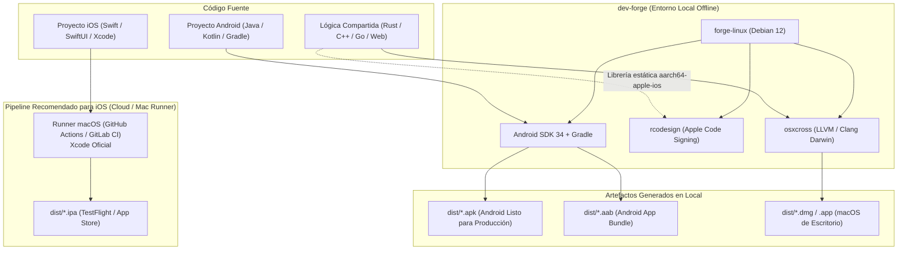

# Lenguajes y Ecosistemas Soportados en `dev-forge`

`dev-forge` incluye en sus máquinas virtuales los entornos de compilación y empaquetado para los principales lenguajes de desarrollo de software:

| Ecosistema | Detección Automática | Herramientas en `forge-linux` | Herramientas en `forge-windows` | Destinos de Compilación |
| :--- | :--- | :--- | :--- | :--- |
| **Rust** | `Cargo.toml` | Rustup (Stable, Musl, Darwin), Mold, Clang | Rustup MSVC (`x86_64-pc-windows-msvc`), Visual Studio 2022 | Linux x86_64/arm64, Windows .exe, macOS Mach-O |
| **Rust + Tauri (GUI)** | `src-tauri/tauri.conf.json` | WebKit2GTK, GTK3, AppIndicator, Node.js 20, Npm, Cargo | WebView2, Node.js 20, MSVC, WiX Toolset, InnoSetup | Linux .AppImage / .deb, Windows .msi / .exe, macOS .app / .dmg |
| **Java & Android** | `build.gradle`, `gradlew`, `pom.xml` | OpenJDK 21 LTS, Gradle, Android SDK Command-line Tools | OpenJDK 21 LTS, Gradle Windows | Linux/Windows JARs/Fat-JARs, Android APK / AAB |
| **Python** | `pyproject.toml`, `requirements.txt` | Python 3.12, UV, Pip, Pipx, PyInstaller | Python 3.12, Pip, PyInstaller | Linux ELF autocontenido, Windows .exe autocontenido |
| **Go** | `go.mod` | Go 1.23.2 Toolchain | Go 1.23.2 para Windows | Binarios estáticos Linux, Windows .exe, macOS |
| **C / C++** | `CMakeLists.txt`, `Makefile` | GCC 12, Clang/LLVM 16, CMake, Make, OpenSSL | MSVC 2022 C++ Build Tools, CMake, NMake | Binarios nativos ELF Linux, Windows PE32+ .exe |
| **Node.js / Web** | `package.json` | Node.js 20 LTS, Corepack (pnpm, yarn) | Node.js 20 LTS, npm | Bundles web (Vite, Rollup, Webpack) |

---

## 1. Ejemplos de Invocación

### Proyecto en Rust (o Rust + Tauri):
```bash
dev-forge build -p /home/usuario/DEV/rust/lexishield -t all
```

### Proyecto en Java / Android:
```bash
dev-forge build -p /home/usuario/DEV/mi-app-movil -t android
```

### Proyecto en Python:
```bash
dev-forge build -p /home/usuario/DEV/mi-script -t windows
```

### Proyecto en Go:
```bash
dev-forge build -p /home/usuario/DEV/mi-microservicio -t linux
```

---

## 2. Desarrollo Móvil: Android vs. iOS (Límites y Arquitectura)

`dev-forge` está diseñado para aislar y resolver la compilación de aplicaciones de forma 100% offline y local. Sin embargo, en el ámbito móvil existen diferencias estructurales fundamentales impuestas por los fabricantes de cada plataforma:



### Android: Soporte Completo Local
- **Toolchain Abierto**: Google distribuye el Android SDK, NDK y Gradle de forma nativa para Linux x86_64.
- **Empaquetado Autónomo**: `forge-linux` compila y empaqueta `.apk` y `.aab` de forma totalmente offline y desatendida.
- **Sin Dependencias de Hardware Propietario**: No se requieren licencias adicionales ni hardware específico.

### iOS (iPhone / iPad): Restricciones Técnicas y Legales de Apple
A diferencia de Android o macOS de escritorio, **la compilación completa de una app nativa para iPhone (`.ipa`) no es posible de manera 100% nativa en máquinas virtuales Linux/Windows estándar** debido a los siguientes factores:

1. **Dependencia de Xcode**:
   - Los compiladores de recursos visuales de iOS (`actool` para catálogos de assets `.car`, `ibtool` para Storyboards/XIBs, y el compilador de SwiftUI) son utilidades cerradas y propietarias de Apple que **solo existen y se ejecutan dentro del sistema operativo macOS**.
2. **Restricción de Licencia (Apple EULA)**:
   - El contrato de licencia de Apple prohíbe explícitamente virtualizar o ejecutar macOS y sus herramientas de desarrollo sobre hardware que no sea genuino de Apple.
3. **Simulador Exclusivo**:
   - El simulador de iPhone/iPad depende del subsistema gráfico Metal y frameworks Cocoa Touch nativos de macOS; no existe emulador de iOS para Linux o Windows.

### ¿Qué capacidades relacionadas con Apple SÍ incluye `dev-forge`?
- **macOS de Escritorio**: Compilación cruzada completa de binarios Mach-O, bundles `.app` y empaquetado en imágenes `.dmg` con `osxcross` y `dmgbuild`.
- **Librerías Nativas para iOS**: Compilación de lógica en Rust (`aarch64-apple-ios`) o C/C++ como librerías estáticas `.a` utilizables en proyectos iOS.
- **Firmado Criptográfico**: Herramienta `rcodesign` en `forge-linux` capaz de firmar paquetes `.ipa` y bundles desde Linux si se cuenta con certificados de desarrollador (`.p12`) y perfiles `.mobileprovision`.

### Flujo de Trabajo Profesional Recomendado para iOS
Para equipos o desarrolladores que trabajan en entornos Linux/Windows con `dev-forge`:
1. **Desarrollo y pruebas locales**: Se diseña la lógica, interfaz común o versión Android en local con `dev-forge`.
2. **Construcción final en CI/CD**: Se delega la compilación final del `.ipa` de iOS a un runner con macOS oficial (por ejemplo, el runner gratuito `macos-latest` en GitHub Actions o Codemagic), el cual ejecuta `xcodebuild` y sube el binario directamente a **TestFlight** o a la **App Store**.


