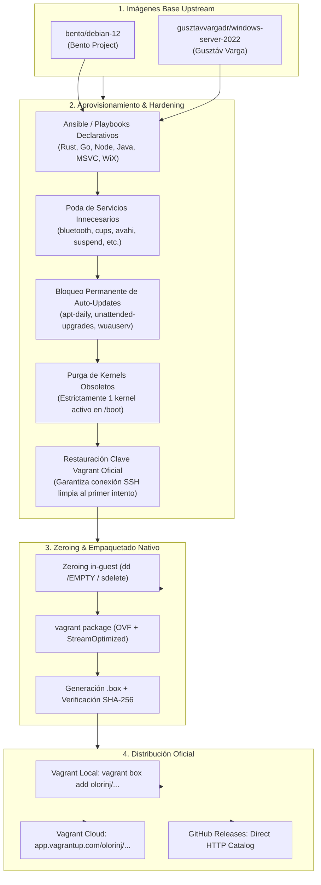
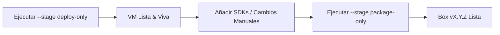

# Guía de custom boxes de despliegue instantáneo (DevForge)

Esta guía documenta la arquitectura, optimizaciones, procedimiento de empaquetado y publicación de las imágenes virtuales oficiales de DevForge (`forge-linux`, `forge-windows` y `forge-runner`) empaquetadas conforme al estándar nativo oficial de Vagrant para máxima compatibilidad y arranque instantáneo.



---

## 1. Imágenes de origen y atribución upstream

DevForge construye sus entornos aislados sobre cajas base mantenidas por la comunidad de software libre. Se preserva y documenta su atribución original:

| Máquina DevForge | Namespace Vagrant Cloud | Imagen Base Upstream | Proveedor Original | URL del Repositorio Upstream |
| :--- | :--- | :--- | :--- | :--- |
| **`forge-linux`** | `olorinj/dev-forge-linux` | `bento/debian-12` (v202510.26.0) | Bento Project (Chef Software) | [https://app.vagrantup.com/bento/boxes/debian-12](https://app.vagrantup.com/bento/boxes/debian-12) |
| **`forge-windows`** | `olorinj/dev-forge-windows` | `gusztavvargadr/windows-server-2022-standard-core` | Gusztáv Varga | [https://app.vagrantup.com/gusztavvargadr/boxes/windows-server-2022-standard-core](https://app.vagrantup.com/gusztavvargadr/boxes/windows-server-2022-standard-core) |
| **`forge-runner`** | `olorinj/dev-forge-runner` | `bento/debian-12` (v202510.26.0) | Bento Project (Chef Software) | [https://app.vagrantup.com/bento/boxes/debian-12](https://app.vagrantup.com/bento/boxes/debian-12) |

---

## 2. Optimizaciones de reducción de tamaño y seguridad

Para garantizar compilaciones 100% deterministas, arranques instantáneos (~15 segundos) y mínima huella en disco:

### 2.1 Desactivación de actualizaciones automáticas
- **Linux (`forge-linux` / `forge-runner`)**:
  - Enmascaramiento completo y permanente (`systemctl mask`) de `unattended-upgrades.service`, `apt-daily.timer`, `apt-daily.service`, `apt-daily-upgrade.timer` y `apt-daily-upgrade.service`.
  - Configuración estricta en `/etc/apt/apt.conf.d/99devforge-no-periodic-updates` anulando toda descarga o actualización desatendida.
- **Windows (`forge-windows`)**:
  - Detención y deshabilitación permanente de los servicios `wuauserv` (Windows Update), `UsoSvc` (Update Orchestrator Service) y `WaaSMedicSvc`.
  - Deshabilitación de todas las tareas programadas de update (`\Microsoft\Windows\WindowsUpdate\*`).
  - Fijación forzada en el Registro de la directiva de grupo `NoAutoUpdate = 1` y `AUOptions = 1`.

### 2.2 Política estricta de un solo núcleo de kernel activo (Linux)
- El script de preparación inspecciona el kernel en ejecución con `uname -r`.
- Purga automáticamente todos los paquetes `linux-image-*` y `linux-headers-*` secundarios u obsoletos acumulados.
- Regenera el initramfs y actualiza GRUB (`update-grub`), garantizando que `/boot` y `/lib/modules` alberguen estrictamente **un único kernel limpio**, reduciendo drásticamente el tamaño del disco y evitando inconsistencias en arranque.

### 2.3 Poda de servicios innecesarios
- **Linux**: Desactivación y enmascaramiento de `bluetooth`, `cups` (impresoras), `avahi-daemon` (mDNS), `modemmanager`, `whoopsie`/`apport` (telemetría), `sleep.target`, `suspend.target`, `hibernate.target` y `systemd-timesyncd` (la hora se sincroniza directamente por el hypervisor VirtualBox).
- **Windows**: Desactivación de Windows Search Indexing (`WSearch`), Superfetch (`SysMain`), cola de impresión (`Spooler`), telemetría (`DiagTrack`) y reporte de errores (`WerSvc`).
- **Limpieza de almacén WinSxS**: Ejecución de `dism.exe /online /cleanup-image /startcomponentcleanup /resetbase` y eliminación de puntos de restauración VSS (`vssadmin delete shadows /all /quiet`).

### 2.4 Llenado de ceros y empaquetado estándar Vagrant
- **Linux**: Rellenado de espacio no asignado con `dd if=/dev/zero of=/EMPTY bs=1M; sync; rm -f /EMPTY`.
- **Windows**: Rellenado de bloques libres mediante Sysinternals `sdelete.exe -z C:`.
- **Restauración SSH**: Inyección de la clave pública insegura oficial de Vagrant en `/home/vagrant/.ssh/authorized_keys` para garantizar que cualquier host se autentique sin timeouts en el primer arranque.
- **Empaquetado oficial**: Empaquetado mediante `vagrant package` generando discos OVF compatibles (StreamOptimized) que se importan de forma instantánea sin incompatibilidades de formato de disco en ninguna versión de VirtualBox.

---

## 3. Estrategia de dos capas: cómo ampliar o modificar las boxes a posteriori

Las boxes pre-compiladas **no congelan** los entornos. El flujo recomendado para añadir nuevos lenguajes (ej. Swift, Zig, Haskell, .NET) se estructura en dos fases:

### Fase 1: prototipado rápido con Ansible en Git (1 a 2 minutos)
1. La **Fuente de la Verdad** es el repositorio Git. Añades la tarea o receta de instalación del nuevo lenguaje en `provision/ansible/linux.yml` o `provision/ansible/windows.yml`.
2. Ejecutas el aprovisionamiento sobre tu VM activa:
   ```bash
   dev-forge provision forge-linux
   ```
3. Ansible detectará que los lenguajes existentes ya están presentes (idempotencia) e instalará **únicamente** el nuevo lenguaje.
4. Puedes compilar y probar proyectos en tu entorno de inmediato.

### Fase 2: congelación y publicación de nueva versión
Cuando el nuevo lenguaje esté validado (por ejemplo, compilando un ejemplo en `examples/hashforge/`):
```bash
dev-forge box package forge-linux --version 1.1.0
```
El CLI ejecutará la poda, purga de kernels, zeroing, compactación VDI, generará la box `dev-forge-linux-v1.1.0.box` y la dejará lista para publicar la nueva versión oficial.

---

## 4. Reconstrucción autónoma y flujo por etapas

La CLI de `dev-forge` ofrece dos flujos de trabajo: ejecución total desatendida o ejecución por etapas (`--stage deploy-only` y `--stage package-only`) para iterar antes de congelar una nueva versión:



### 4.1 Flujo por etapas (iteración y modificaciones previas)
1. **Desplegar en limpio y detenerse antes de optimizar**:
   ```bash
   dev-forge box rebuild linux --version 1.1.0 --stage deploy-only
   # o para Windows:
   dev-forge box rebuild windows --version 1.1.0 --stage deploy-only
   ```
2. **Acceder a la máquina e introducir mejoras/pruebas**:
   ```bash
   vagrant ssh forge-linux
   # o en Windows:
   vagrant winrm forge-windows -s powershell -c "..."
   ```
3. **Optimizar, empaquetar y validar la nueva box**:
   ```bash
   dev-forge box rebuild linux --version 1.1.0 --stage package-only
   # o para Windows:
   dev-forge box rebuild windows --version 1.1.0 --stage package-only
   ```

### 4.2 Flujo directo de reconstrucción total
```bash
# Reconstruir una máquina específica
dev-forge box rebuild linux --version 1.1.0
dev-forge box rebuild windows --version 1.1.0
dev-forge box rebuild runner --version 1.1.0

# O reconstruir todas en secuencia con exclusión mutua de RAM
dev-forge box rebuild all --version 1.1.0
```

---

## 5. Empaquetado y prueba local con la CLI

DevForge integra comandos nativos en su orquestador Rust para gestionar todo el ciclo de vida sin depender de scripts externos:

```bash
# Empaquetar la VM forge-linux con disco VDI
dev-forge box package forge-linux --version 1.0.0

# Empaquetar todas las VMs (forge-linux, forge-windows, forge-runner)
dev-forge box package all --version 1.0.0

# Registrar la box generada localmente en Vagrant para pruebas inmediatas
dev-forge box install forge-linux

# Listar boxes de DevForge instaladas en el sistema local
dev-forge box list
```

---

## 6. Publicación en Vagrant Cloud (`app.vagrantup.com`)

### 6.1 Publicación automatizada multiplataforma con `dev-forge box publish`

La publicación se gestiona directamente desde el orquestador en Rust, con validación previa de sumas SHA-256, modo simulación (`--dry-run`), soporte desatendido para CI/CD (`--yes`), y resolución segura de la organización destino (vía `--user`, variable `DEVFORGE_BOX_ORG` o `VAGRANT_CLOUD_USER`):

```bash
# Simular la publicación de todas las boxes (sin transferir tráfico de red)
dev-forge box publish all --version 1.0.0 --user mi-organizacion --dry-run

# Publicar una box individual (ej. forge-linux)
dev-forge box publish linux --version 1.0.0 --user mi-organizacion

# Publicar todas las boxes de forma desatendida para CI/CD o agentes
dev-forge box publish all --version 1.0.0 --user mi-organizacion --yes
```

---

### 6.2 Publicación manual directa vía Vagrant CLI

1. **Iniciar sesión en Vagrant Cloud desde la terminal**:
   ```bash
   vagrant cloud auth login
   ```
   (Introduce tu token de acceso o autoriza la sesión en el navegador).

2. **Crear y subir la versión de la box**:
   ```bash
   # Para forge-linux
   vagrant cloud publish mi-org/dev-forge-linux 1.0.0 virtualbox dist/boxes/dev-forge-linux-v1.0.0.box \
       --description "DevForge Linux Native Build Box (Debian 12 + Rust/Go/Node/Java/Docker/VDI)" \
       --version-description "Release v1.0.0: Pre-baked toolchains, zero auto-updates, single active kernel." \
       --release

   # Para forge-windows
   vagrant cloud publish mi-org/dev-forge-windows 1.0.0 virtualbox dist/boxes/dev-forge-windows-v1.0.0.box \
       --description "DevForge Windows Native Build Box (WinServer 2022 Core + MSVC/WiX/Inno/VDI)" \
       --version-description "Release v1.0.0: Pre-baked Visual Studio 2022 Build Tools, WiX 3.14, InnoSetup." \
       --release

   # Para forge-runner
   vagrant cloud publish mi-org/dev-forge-runner 1.0.0 virtualbox dist/boxes/dev-forge-runner-v1.0.0.box \
       --description "DevForge CI/CD Runner Box (Debian 12 + GitLab Runner + Docker Engine)" \
       --version-description "Release v1.0.0: Isolated local CI/CD execution environment." \
       --release
   ```

### 6.3 Alternativa: alojamiento directo en GitHub Releases
Si prefieres no usar el registro central de HashiCorp, puedes subir los archivos `.box` como activos adjuntos a un Release de GitHub (`https://github.com/olorinj/dev-forge/releases/tag/v1.0.0`).

Vagrant puede consumir directamente el manifiesto de catálogo JSON versionado ubicado en `config/boxes/metadata-linux.json`:
```ruby
config.vm.box = "dev-forge/linux"
config.vm.box_url = "https://raw.githubusercontent.com/olorinj/dev-forge/main/config/boxes/metadata-linux.json"
```

