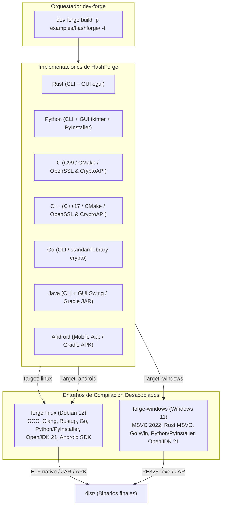

# HashForge - Suite de Validación Multi-Lenguaje y Multi-VM

**HashForge** es una suite criptográfica (CLI y GUI) desarrollada como banco de pruebas integral para verificar la capacidad del orquestador **`dev-forge`** de compilar ejecutables nativos en múltiples lenguajes de programación a través de máquinas virtuales aisladas (**Linux** y **Windows**).

Todos los lenguajes implementan exactamente la misma especificación criptográfica: cálculo simultáneo de resúmenes **SHA-256** y **MD5** con salida formateada y en JSON.



---

## 1. Implementaciones Disponibles

| Directorio | Lenguaje | GUI / CLI | Sistema de Construcción | Binario Linux | Binario Windows / Android |
| :--- | :--- | :--- | :--- | :--- | :--- |
| [`rust/`](rust/) | **Rust 2021** | CLI + GUI (`egui`/`eframe`) | Cargo | `dist/hashforge` | `dist/hashforge.exe` |
| [`python/`](python/) | **Python 3.12** | CLI + GUI (`tkinter`) | PyInstaller standalone | `dist/hashforge-py` | `dist/hashforge-py.exe` |
| [`c/`](c/) | **C (C99)** | CLI | CMake / Makefile | `dist/hashforge-c` | `dist/hashforge-c.exe` |
| [`cpp/`](cpp/) | **C++ (C++17)** | CLI | CMake / Makefile | `dist/hashforge-cpp` | `dist/hashforge-cpp.exe` |
| [`go/`](go/) | **Go 1.23** | CLI | Go toolchain (`go build`) | `dist/hashforge-go` | `dist/hashforge-go.exe` |
| [`java/`](java/) | **Java 21 LTS** | CLI + GUI (`Swing`) | Gradle (`java`/`application`) | `dist/hashforge-java.jar` | `dist/hashforge-java.jar` |
| [`android/`](android/) | **Android (Java/SDK 34)** | App Móvil Nativa | Android Gradle Plugin (AGP) | N/A | `dist/*.apk` |

---

## 2. Compilación Individual de Lenguajes con `dev-forge`

```bash
# Compilar Rust para Linux en forge-linux
dev-forge build -p examples/hashforge/rust -t linux

# Compilar Python para Windows en forge-windows (genera .exe autocontenido)
dev-forge build -p examples/hashforge/python -t windows

# Compilar C para Linux en forge-linux
dev-forge build -p examples/hashforge/c -t linux

# Compilar C++ para Windows en forge-windows (compilador nativo MSVC)
dev-forge build -p examples/hashforge/cpp -t windows

# Compilar Go para ambas VMs
dev-forge build -p examples/hashforge/go -t all

# Compilar Java (genera paquete JAR autocontenido para Linux y Windows)
dev-forge build -p examples/hashforge/java -t all

# Compilar App Móvil Android (genera paquete APK)
dev-forge build -p examples/hashforge/android -t android
```

---

## 3. Ejecución de Pruebas Automatizadas

Cada subcarpeta de lenguaje contiene su propio `test.sh` y `test.ps1`. Adicionalmente, el directorio raíz de `hashforge` cuenta con un **orquestador maestro de pruebas**:

### En Linux / Bash:
```bash
# Probar un lenguaje específico en forge-linux:
./test.sh rust linux
./test.sh python linux
./test.sh c linux
./test.sh cpp linux
./test.sh go linux
./test.sh java linux
./test.sh android android

# Probar un lenguaje específico en forge-windows:
./test.sh rust windows
./test.sh java windows

# Probar TODOS los lenguajes en AMBAS VMs:
./test.sh all all
```

### En Windows / PowerShell:
```powershell
# Probar un lenguaje específico:
.\test.ps1 -Language rust -Target windows
.\test.ps1 -Language python -Target windows
.\test.ps1 -Language java -Target windows
.\test.ps1 -Language android -Target android

# Probar TODOS los lenguajes en AMBAS VMs:
.\test.ps1 -Language all -Target all
```
