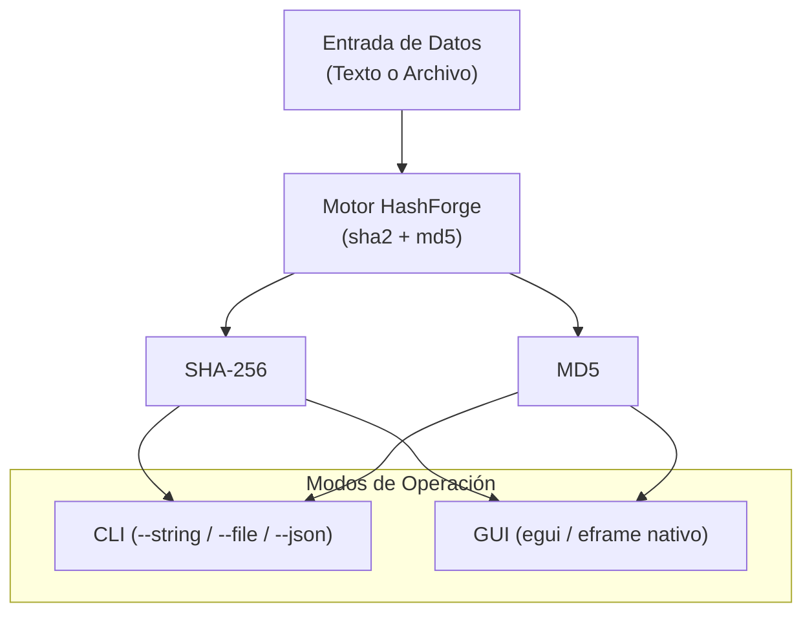

# HashForge

HashForge es una utilidad criptográfica multiplataforma (CLI y GUI) desarrollada en Rust como proyecto de prueba y validación para el orquestador **`dev-forge`**.

Calcula simultáneamente resúmenes criptográficos SHA-256 y MD5 a partir de cadenas de texto o ficheros arbitrarios.



## Características
- **Modo CLI**: Cálculos instantáneos desde terminal con soporte de salida en texto formateado y JSON (`--json`).
- **Modo GUI**: Interfaz gráfica nativa responsiva construida con `egui`/`eframe`, con cambio de tema claro/oscuro y botones de copiado al portapapeles.
- **Multiplataforma**: Compila nativamente en Linux (ELF x86_64) y Windows (MSVC PE32+ `.exe`).

## Compilación con dev-forge

```bash
# Compilar para Linux
dev-forge build -p examples/hashforge -t linux

# Compilar para Windows (MSVC)
dev-forge build -p examples/hashforge -t windows

# Compilar para todas las plataformas soportadas
dev-forge build -p examples/hashforge -t all
```

Los binarios generados se depositarán automáticamente en `examples/hashforge/dist/`.

## Ejecución de Pruebas Automatizadas

```bash
# En sistemas Linux / Bash
./test.sh [linux|windows|all]

# En sistemas Windows / PowerShell
.\test.ps1 [-Target linux|windows|all]
```

